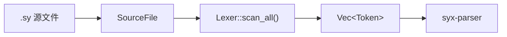

# SYX 编译器 - 词法分析文档

> **现状对齐：** SYX **117.0** · Phase **139** · `syx-cache-v1` · 许可证 [Apache-2.0](../LICENSE)  
> 实现状态 SSOT：[books/shared/implementation-status.md](../books/shared/implementation-status.md) · 文档索引：[README.md](./README.md)

## 1. 概述

词法分析器（Lexer）是 SYX 编译器流水线的第一阶段，负责将 `.sy` 源代码文本转换为 `Token` 序列，供 `syx-parser` 进行语法分析。

当前实现位于 **`crates/syx-lexer/`**，采用单遍扫描器设计：

- 入口：`Lexer::new(source)` 或 `Lexer::from_str(name, contents)`
- 输出：`SyxResult<Vec<Token>>`，通过 `scan_all()` 完成全文件扫描
- 依赖：`syx-diagnostics`（`SourceFile`、`Span`、`SyxDiagnostic`）、`smol_str`（紧凑字符串）

Token 类型定义在 `crates/syx-lexer/src/token.rs`，扫描逻辑在 `crates/syx-lexer/src/lib.rs`。

## 2. 架构

### 2.1 数据流



### 2.2 Lexer 结构体

```rust
// crates/syx-lexer/src/lib.rs
pub struct Lexer {
    source: SourceFile,       // 源文件（含路径与内容）
    chars: Vec<char>,         // 预展开的 Unicode 字符缓冲
    current: usize,           // 当前扫描位置
    start: usize,             // 当前 Token 起始位置
    line: usize,              // 当前行号（从 1 开始）
    column: usize,            // 当前列号
    tokens: Vec<Token>,       // 已收集的 Token 列表
    last_sig: Option<TokenKind>, // 上一个"有意义" Token（用于正则字面量消歧）
}
```

`last_sig` 记录最近一个非 `Newline`、非 `Eof` 的 Token，供 `/` 字符判断是除法运算符还是正则字面量起始符。

### 2.3 Token 结构

```rust
// crates/syx-lexer/src/token.rs
#[derive(Debug, Clone, PartialEq)]
pub struct Token {
    pub kind: TokenKind,
    pub lexeme: SmolStr,   // 原始文本切片
    pub span: Span,        // 字节偏移与长度
    pub line: usize,
    pub column: usize,
}
```

每个 Token 在 `add_token()` 中生成：`lexeme` 取自 `chars[start..current]`，`line`/`column` 由 `SourceFile::line_col(start)` 计算。

### 2.4 主扫描流程

```
scan_all():
    while not at_end:
        start = current
        scan_token()?
    add_token(Eof)
    return tokens
```

```
scan_token():
    ch = advance()
    match ch:
        单字符分隔符 → 直接 add_token
        '/'          → 行注释 | 块注释 | 正则 | Slash
        '"'          → string()
        数字         → number()
        标识符起始   → identifier()
        空白符       → 跳过
        '\n'         → Newline + 更新行号
        其他         → L001 错误
```

## 3. TokenKind 分类

`TokenKind` 枚举定义于 `crates/syx-lexer/src/token.rs`，按语义分组如下。

### 3.1 声明关键字

| TokenKind | 词素 | 示例 |
|-----------|------|------|
| `Class` | `class` | `class Foo {}` |
| `Struct` | `struct` | `struct Point {}` |
| `Enum` | `enum` | `enum Status {}` |
| `Protocol` | `protocol` | `protocol Drawable {}` |
| `Extension` | `extension` | `extension Int {}` |
| `Func` | `func` | `func add() {}` |
| `Init` | `init` | `init() {}` |
| `Deinit` | `deinit` | `deinit {}` |
| `Import` | `import` | `import math` |
| `Data` | `data` | `data class User(...)` |
| `Sealed` | `sealed` | `sealed class Result {}` |
| `Actor` | `actor` | `actor Counter {}` |
| `Service` | `Service` | 服务声明 |
| `Macro` | `macro` | 宏声明 |
| `Type` | `type` | 类型别名 |

### 3.2 变量声明

| TokenKind | 词素 | 示例 |
|-----------|------|------|
| `Var` | `var` | `var x = 5` |
| `Let` | `let` | `let y = 10` |

### 3.3 控制流关键字

| TokenKind | 词素 | 示例 |
|-----------|------|------|
| `If` / `Else` | `if` / `else` | `if (x > 0) {} else {}` |
| `Guard` | `guard` | `guard let x = opt else {}` |
| `Switch` / `Case` / `Default` | `switch` / `case` / `default` | `switch x { case 1: ... }` |
| `For` / `In` | `for` / `in` | `for i in items {}` |
| `While` | `while` | `while (cond) {}` |
| `Repeat` | `repeat` | `repeat {} while cond` |
| `Break` / `Continue` | `break` / `continue` | 控制转移 |
| `Return` | `return` | `return value` |
| `Async` / `Await` | `async` / `await` | `async func f() { await g() }` |

### 3.4 错误处理

| TokenKind | 词素 | 示例 |
|-----------|------|------|
| `Try` | `try` | `try expr` 或 `try { } catch {}` |
| `Throw` | `throw` | `throw error` |
| `Throws` | `throws` | `func f() throws {}` |
| `Catch` | `catch` | `catch (e) {}` |

### 3.5 访问控制与修饰符

| TokenKind | 词素 | 说明 |
|-----------|------|------|
| `Public` | `public` | 公开访问 |
| `Internal` | `internal` | 内部访问（默认） |
| `Private` | `private` | 私有 |
| `Static` | `static` | 静态成员 |
| `Weak` | `weak` | 弱引用 |
| `Unowned` | `unowned` | 无主引用 |
| `Mutating` | `mutating` | 可变异方法 |

### 3.6 类型与约束关键字

| TokenKind | 词素 | 说明 |
|-----------|------|------|
| `SelfKw` | `self` | 实例引用 |
| `SelfType` | `Self` | 类型 Self |
| `ProtocolKw` | `Protocol` | 协议类型 |
| `Where` | `where` | 泛型约束 |
| `Requires` | `requires` | 函数效果约束 |
| `Pure` | `Pure` | 纯函数效果 |
| `Io` | `IO` | IO 效果 |

> 注：`TokenKind::CompileTime` 已在枚举中预留，但 `keyword()` 尚未映射对应词素。

### 3.7 字面量

| TokenKind | 说明 | 示例 |
|-----------|------|------|
| `Integer(i64)` | 整数字面量 | `42`, `-7` |
| `Double(f64)` | 浮点字面量 | `3.14` |
| `String(String)` | 普通字符串 | `"hello"` |
| `InterpolatedString(Vec<InterpPart>)` | 插值字符串 | `"x=\(x)"` |
| `Regex(String)` | 正则字面量 | `/pattern/` |
| `Bool(bool)` | 布尔字面量 | `true`, `false` |
| `Nil` | 空值 | `nil` |

### 3.8 运算符与分隔符

| 类别 | TokenKind | 符号 |
|------|-----------|------|
| 算术 | `Plus`, `Minus`, `Star`, `Slash`, `Percent` | `+` `-` `*` `/` `%` |
| 比较 | `EqualEqual`, `NotEqual`, `Less`, `LessEqual`, `Greater`, `GreaterEqual` | `==` `!=` `<` `<=` `>` `>=` |
| 逻辑 | `AndAnd`, `OrOr`, `Bang` | `&&` `\|\|` `!` |
| 赋值 | `Assign` | `=` |
| 可选 | `Question`, `NilCoalesce` | `?` `??` |
| 范围 | `Dot`, `DotDotDot`, `DotDotLess`, `Range` | `.` `...` `..<` `..` |
| 箭头 | `Arrow`, `FatArrow` | `->` `=>` |
| 分隔符 | `LParen`…`RBracket`, `Comma`, `Colon`, `Semicolon` | `()` `{}` `[]` `,` `:` `;` |
| 特殊 | `At`, `Hash`, `Newline`, `Eof` | `@` `#` 换行 文件结束 |

### 3.9 标识符

未匹配关键字的标识符记为 `Identifier(SmolStr)`。标识符规则（ADR-229 / `M2-S2-04`）：

- 首字符：`_` 或 Unicode **XID_Start**（`unicode-xid`；`is_ident_start`）
- 后续字符：`_` 或 Unicode **XID_Continue**（`is_ident_part`）
- 存储为源码 UTF-8 拼写原样；**不**对标识符做 NFC；**不**做 UTS #39 confusables
- 非 XID_Start（如 emoji `😀`）→ 词法错误

## 4. 详细设计

### 4.1 关键字表 `keyword()`

关键字通过 `keyword(text: &str) -> Option<TokenKind>` 函数查找，定义于 `crates/syx-lexer/src/token.rs`：

```rust
pub fn keyword(text: &str) -> Option<TokenKind> {
    Some(match text {
        "class" => TokenKind::Class,
        "struct" => TokenKind::Struct,
        "enum" => TokenKind::Enum,
        "protocol" => TokenKind::Protocol,
        "extension" => TokenKind::Extension,
        "func" => TokenKind::Func,
        "init" => TokenKind::Init,
        "deinit" => TokenKind::Deinit,
        "var" => TokenKind::Var,
        "let" => TokenKind::Let,
        "import" => TokenKind::Import,
        "public" => TokenKind::Public,
        "internal" => TokenKind::Internal,
        "private" => TokenKind::Private,
        "static" => TokenKind::Static,
        "async" => TokenKind::Async,
        "await" => TokenKind::Await,
        "actor" => TokenKind::Actor,
        "data" => TokenKind::Data,
        "sealed" => TokenKind::Sealed,
        "where" => TokenKind::Where,
        "requires" => TokenKind::Requires,
        "Pure" => TokenKind::Pure,
        "IO" => TokenKind::Io,
        "Service" => TokenKind::Service,
        "macro" => TokenKind::Macro,
        "if" => TokenKind::If,
        "else" => TokenKind::Else,
        "guard" => TokenKind::Guard,
        "switch" => TokenKind::Switch,
        "case" => TokenKind::Case,
        "default" => TokenKind::Default,
        "for" => TokenKind::For,
        "in" => TokenKind::In,
        "while" => TokenKind::While,
        "repeat" => TokenKind::Repeat,
        "break" => TokenKind::Break,
        "continue" => TokenKind::Continue,
        "return" => TokenKind::Return,
        "try" => TokenKind::Try,
        "throw" => TokenKind::Throw,
        "throws" => TokenKind::Throws,
        "catch" => TokenKind::Catch,
        "self" => TokenKind::SelfKw,
        "Self" => TokenKind::SelfType,
        "type" => TokenKind::Type,
        "Protocol" => TokenKind::ProtocolKw,
        "weak" => TokenKind::Weak,
        "unowned" => TokenKind::Unowned,
        "mutating" => TokenKind::Mutating,
        "true" => TokenKind::Bool(true),
        "false" => TokenKind::Bool(false),
        "nil" => TokenKind::Nil,
        _ => return None,
    })
}
```

`identifier()` 在扫描完标识符文本后调用 `keyword()`；返回 `None` 时生成 `Identifier`。

### 4.2 注释处理

#### 单行注释

遇到 `//` 时，跳过至行尾（不含换行符），不产生 Token：

```syx
let x = 1  // 这是注释
```

#### 块注释（支持嵌套）

遇到 `/*` 时进入 `block_comment()`，用深度计数器处理嵌套：

```
/* 外层
   /* 内层 */
   继续
*/
```

未闭合时报告 **L001** 错误：`"Unterminated block comment"`。

空白字符（空格、`\t`、`\r`）在 `scan_token()` 中直接跳过，不产生 Token。

### 4.3 数字字面量

`number()` 扫描连续数字；若 `.` 后紧跟数字则解析为浮点：

```rust
// 整数 → TokenKind::Integer(i64)
// 浮点 → TokenKind::Double(f64)
// 文本: chars[start..current]
```

注意：单独的 `.` 不会作为浮点的一部分（例如 `3.` 仅产出 `Integer(3)` 和 `Dot`）。

### 4.4 字符串字面量

#### 普通字符串

`string()` 处理双引号字符串，支持转义：

| 转义 | 含义 |
|------|------|
| `\n` | 换行 |
| `\t` | 制表符 |
| `\\` | 反斜杠 |
| `\"` | 双引号 |
| 其他 | 保留 `\` + 字符 |

字符串内不允许裸换行；未闭合报告 L001。

#### 插值字符串

遇到 `\(` 时进入插值模式，用括号深度匹配表达式边界：

```rust
#[derive(Debug, Clone, PartialEq)]
pub enum InterpPart {
    Text(String),   // 静态文本段
    Expr(String),   // 原始表达式文本（由 parser 二次解析）
}
```

- 仅含一段纯文本 → `TokenKind::String`
- 含插值段 → `TokenKind::InterpolatedString(parts)`
- 空字符串 → `TokenKind::String("")`

示例：

```syx
let msg = "Hello, \(name)!"
// → InterpolatedString([Text("Hello, "), Expr("name"), Text("!")])
```

### 4.5 正则字面量

`/` 字符的消歧逻辑：

```
'/' 后接 '/'  → 单行注释
'/' 后接 '*'  → 块注释
can_start_regex() == true → regex_literal()
否则          → TokenKind::Slash
```

`can_start_regex()` 在以下"前一个有意义 Token"时返回 `true`：

- 文件起始（`last_sig == None`）
- 左括号、左方括号、逗号、冒号、分号
- 赋值、算术/比较/逻辑运算符
- `return`、`in`、`try`、箭头运算符

`regex_literal()` 扫描至闭合 `/`，支持 `\"` 式转义，产出 `TokenKind::Regex(pattern)`。

```syx
let re = /[a-z]+/
// 前一个 Token 为 Assign，触发正则模式
```

### 4.6 运算符扫描

多字符运算符通过 `match_char()` 前瞻合并：

| 首字符 | 前瞻 | TokenKind |
|--------|------|-----------|
| `!` | `=` | `NotEqual` |
| `!` | — | `Bang` |
| `=` | `=` | `EqualEqual` |
| `=` | `>` | `FatArrow` |
| `=` | — | `Assign` |
| `-` | `>` | `Arrow` |
| `-` | — | `Minus` |
| `<` | `=` | `LessEqual` |
| `<` | `.` | `DotDotLess` |
| `>` | `=` | `GreaterEqual` |
| `&` | `&` | `AndAnd` |
| `\|` | `\|` | `OrOr` |
| `?` | `?` | `NilCoalesce` |
| `?` | — | `Question` |
| `.` | `.` + `<` | `DotDotLess` |
| `.` | `.` + `.` | `DotDotDot` |
| `.` | `.` | `Range` |
| `.` | — | `Dot` |

单独的 `&` 或 `|`（非 `&&`/`||`）报告 L001：`"Unexpected character '&'"` / `"Unexpected character '|'"`。

### 4.7 换行符

`\n` 产出 `TokenKind::Newline`，并递增 `line`、重置 `column`。换行符是有意义的 Token，供 parser 处理语句分隔；parser 通过 `skip_newlines()` 和 `peek_index()` 跳过换行。

### 4.8 运算符优先级（供 parser 参考）

词法阶段仅产出运算符 Token；优先级在 `syx-parser` 的 `infix_op()` 中定义：

| 优先级 | 运算符 | TokenKind |
|--------|--------|-----------|
| 1 | `\|\|` | `OrOr` |
| 2 | `&&` | `AndAnd` |
| 3 | `==` `!=` | `EqualEqual` `NotEqual` |
| 4 | `<` `<=` `>` `>=` | `Less` `LessEqual` `Greater` `GreaterEqual` |
| 5 | `+` `-` | `Plus` `Minus` |
| 6 | `*` `/` `%` | `Star` `Slash` `Percent` |
| 7 | `??` | `NilCoalesce` |

## 5. 错误处理

词法错误统一使用诊断码 **L001**，通过 `SyxDiagnostic` 返回：

```rust
fn error(&self, message: impl Into<String>) -> SyxResult<()> {
    Err(SyxDiagnostic::error(message)
        .with_code("L001")
        .with_span(&self.source, Span::new(self.start, ...), "here"))
}
```

常见 L001 错误消息：

| 场景 | 消息 |
|------|------|
| 非法字符 | `Unexpected character '…'` |
| 未闭合字符串 | `Unterminated string literal` |
| 未闭合插值 | `Unterminated string interpolation` |
| 未闭合块注释 | `Unterminated block comment` |
| 未闭合正则 | `Unterminated regex literal` |
| 单独 `&` / `\|` | `Unexpected character '&'` / `'|'` |

`scan_all()` 在遇到第一个 L001 错误时立即返回 `Err`，不继续扫描。

## 6. 使用示例

### 6.1 基本用法

```rust
use syx_diagnostics::SourceFile;
use syx_lexer::{Lexer, TokenKind};

let source = SourceFile::new("hello.sy", r#"func main() { print("hi") }"#);
let tokens = Lexer::new(source).scan_all()?;

for token in &tokens {
    println!("{:?} @ {}:{}", token.kind, token.line, token.column);
}
```

### 6.2 输入与输出

**输入：**

```syx
func add(a: Int, b: Int) -> Int {
    return a + b
}
```

**Token 序列（节选）：**

```
Func          "func"       @ 1:1
Identifier    "add"        @ 1:6
LParen        "("          @ 1:9
Identifier    "a"          @ 1:10
Colon         ":"          @ 1:11
Identifier    "Int"        @ 1:13
Comma         ","          @ 1:16
Identifier    "b"          @ 1:18
Colon         ":"          @ 1:19
Identifier    "Int"        @ 1:21
RParen        ")"          @ 1:24
Arrow         "->"         @ 1:26
Identifier    "Int"        @ 1:29
LBrace        "{"          @ 1:33
Newline       "\n"         @ 1:34
Return        "return"     @ 2:5
Identifier    "a"          @ 2:12
Plus          "+"          @ 2:14
Identifier    "b"          @ 2:16
Newline       "\n"         @ 2:17
RBrace        "}"          @ 3:1
Eof           ""           @ 3:2
```

## 7. 测试

单元测试位于 `crates/syx-lexer/src/lib.rs` 的 `#[cfg(test)]` 模块：

| 测试 | 验证内容 |
|------|----------|
| `lexes_let_binding` | `let x = 42` 产出 `Let`、`Identifier`、`Assign`、`Integer(42)` |
| `lexes_keywords_and_string` | `func` 关键字与 `String("hi")` 字面量 |
| `skips_nested_block_comments` | 嵌套 `/* */` 注释不影响后续 Token |

运行测试：

```bash
cargo test -p syx-lexer
```

## 8. Crate 依赖关系

```
syx-lexer
├── syx-diagnostics   (SourceFile, Span, SyxDiagnostic, SyxResult)
└── smol_str          (SmolStr — Token.lexeme 与 Identifier)
```

下游消费者：`syx-parser` 在 `Parser::parse()` 中调用 `Lexer::new(source).scan_all()?` 获取 Token 流。
