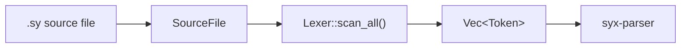

# SYX Compiler — Lexical Analysis

[简体中文](./zh/1_LexicalAnalysis.zh-CN.md)

> **Current alignment:** SYX **117.0** · Phase **139** · `syx-cache-v1` · License [Apache-2.0](../LICENSE)  
> Implementation status SSOT: [books/shared/implementation-status.md](../books/shared/implementation-status.md) · Doc index: [README.md](./README.md)

## 1. Overview

The lexer is the first stage of the SYX compiler pipeline. It turns `.sy` source text into a `Token` stream for `syx-parser` to parse.

The current implementation lives in **`crates/syx-lexer/`** as a single-pass scanner:

- Entry: `Lexer::new(source)` or `Lexer::from_str(name, contents)`
- Output: `SyxResult<Vec<Token>>` via `scan_all()` for a full-file scan
- Dependencies: `syx-diagnostics` (`SourceFile`, `Span`, `SyxDiagnostic`), `smol_str` (compact strings)

Token types are defined in `crates/syx-lexer/src/token.rs`; scanning logic is in `crates/syx-lexer/src/lib.rs`.

## 2. Architecture

### 2.1 Data flow



### 2.2 Lexer struct

```rust
// crates/syx-lexer/src/lib.rs
pub struct Lexer {
    source: SourceFile,       // Source file (path + contents)
    chars: Vec<char>,         // Pre-expanded Unicode character buffer
    current: usize,           // Current scan position
    start: usize,             // Start of current token
    line: usize,              // Current line (1-based)
    column: usize,            // Current column
    tokens: Vec<Token>,       // Collected tokens
    last_sig: Option<TokenKind>, // Last "significant" token (regex literal disambiguation)
}
```

`last_sig` holds the most recent token that is not `Newline` or `Eof`, so `/` can be classified as division or the start of a regex literal.

### 2.3 Token struct

```rust
// crates/syx-lexer/src/token.rs
#[derive(Debug, Clone, PartialEq)]
pub struct Token {
    pub kind: TokenKind,
    pub lexeme: SmolStr,   // Raw text slice
    pub span: Span,        // Byte offset and length
    pub line: usize,
    pub column: usize,
}
```

Each token is produced in `add_token()`: `lexeme` is `chars[start..current]`, and `line`/`column` come from `SourceFile::line_col(start)`.

### 2.4 Main scan loop

```
scan_all():
    while not at_end:
        start = current
        scan_token()?
    add_token(Eof)
    return tokens
```

```
scan_token():
    ch = advance()
    match ch:
        single-char delimiters → add_token directly
        '/'          → line comment | block comment | regex | Slash
        '"'          → string()
        digit        → number()
        ident start  → identifier()
        whitespace   → skip
        '\n'         → Newline + update line
        other        → L001 error
```

## 3. TokenKind categories

The `TokenKind` enum is defined in `crates/syx-lexer/src/token.rs`, grouped by semantics below.

### 3.1 Declaration keywords

| TokenKind | Lexeme | Example |
|-----------|------|------|
| `Class` | `class` | `class Foo {}` |
| `Struct` | `struct` | `struct Point {}` |
| `Enum` | `enum` | `enum Status {}` |
| `Protocol` | `protocol` | `protocol Drawable {}` |
| `Extension` | `extension` | `extension Int {}` |
| `Func` | `func` | `func add() {}` |
| `Init` | `init` | `init() {}` |
| `Deinit` | `deinit` | `deinit {}` |
| `Import` | `import` | `import math` |
| `Data` | `data` | `data class User(...)` |
| `Sealed` | `sealed` | `sealed class Result {}` |
| `Actor` | `actor` | `actor Counter {}` |
| `Service` | `Service` | Service declaration |
| `Macro` | `macro` | Macro declaration |
| `Type` | `type` | Type alias |

### 3.2 Variable declarations

| TokenKind | Lexeme | Example |
|-----------|------|------|
| `Var` | `var` | `var x = 5` |
| `Let` | `let` | `let y = 10` |

### 3.3 Control-flow keywords

| TokenKind | Lexeme | Example |
|-----------|------|------|
| `If` / `Else` | `if` / `else` | `if (x > 0) {} else {}` |
| `Guard` | `guard` | `guard let x = opt else {}` |
| `Switch` / `Case` / `Default` | `switch` / `case` / `default` | `switch x { case 1: ... }` |
| `For` / `In` | `for` / `in` | `for i in items {}` |
| `While` | `while` | `while (cond) {}` |
| `Repeat` | `repeat` | `repeat {} while cond` |
| `Break` / `Continue` | `break` / `continue` | Control transfer |
| `Return` | `return` | `return value` |
| `Async` / `Await` | `async` / `await` | `async func f() { await g() }` |

### 3.4 Error handling

| TokenKind | Lexeme | Example |
|-----------|------|------|
| `Try` | `try` | `try expr` or `try { } catch {}` |
| `Throw` | `throw` | `throw error` |
| `Throws` | `throws` | `func f() throws {}` |
| `Catch` | `catch` | `catch (e) {}` |

### 3.5 Access control and modifiers

| TokenKind | Lexeme | Notes |
|-----------|------|------|
| `Public` | `public` | Public access |
| `Internal` | `internal` | Internal access (default) |
| `Private` | `private` | Private |
| `Static` | `static` | Static member |
| `Weak` | `weak` | Weak reference |
| `Unowned` | `unowned` | Unowned reference |
| `Mutating` | `mutating` | Mutating method |

### 3.6 Type and constraint keywords

| TokenKind | Lexeme | Notes |
|-----------|------|------|
| `SelfKw` | `self` | Instance reference |
| `SelfType` | `Self` | Type Self |
| `ProtocolKw` | `Protocol` | Protocol type |
| `Where` | `where` | Generic constraints |
| `Requires` | `requires` | Function effect constraints |
| `Pure` | `Pure` | Pure function effect |
| `Io` | `IO` | IO effect |

> Note: `TokenKind::CompileTime` is reserved in the enum, but `keyword()` does not yet map a lexeme to it.

### 3.7 Literals

| TokenKind | Description | Example |
|-----------|------|------|
| `Integer(i64)` | Integer literal | `42`, `-7` |
| `Double(f64)` | Floating-point literal | `3.14` |
| `String(String)` | Plain string | `"hello"` |
| `InterpolatedString(Vec<InterpPart>)` | Interpolated string | `"x=\(x)"` |
| `Regex(String)` | Regex literal | `/pattern/` |
| `Bool(bool)` | Boolean literal | `true`, `false` |
| `Nil` | Null value | `nil` |

### 3.8 Operators and delimiters

| Category | TokenKind | Symbols |
|------|-----------|------|
| Arithmetic | `Plus`, `Minus`, `Star`, `Slash`, `Percent` | `+` `-` `*` `/` `%` |
| Comparison | `EqualEqual`, `NotEqual`, `Less`, `LessEqual`, `Greater`, `GreaterEqual` | `==` `!=` `<` `<=` `>` `>=` |
| Logical | `AndAnd`, `OrOr`, `Bang` | `&&` `\|\|` `!` |
| Assignment | `Assign` | `=` |
| Optional | `Question`, `NilCoalesce` | `?` `??` |
| Range | `Dot`, `DotDotDot`, `DotDotLess`, `Range` | `.` `...` `..<` `..` |
| Arrow | `Arrow`, `FatArrow` | `->` `=>` |
| Delimiters | `LParen`…`RBracket`, `Comma`, `Colon`, `Semicolon` | `()` `{}` `[]` `,` `:` `;` |
| Special | `At`, `Hash`, `Newline`, `Eof` | `@` `#` newline end-of-file |

### 3.9 Identifiers

Identifiers that do not match a keyword become `Identifier(SmolStr)`. Rules (ADR-229 / `M2-S2-04`):

- First character: `_` or Unicode **XID_Start** (`unicode-xid`; `is_ident_start`)
- Following characters: `_` or Unicode **XID_Continue** (`is_ident_part`)
- Stored as the source UTF-8 spelling; **no** NFC on identifiers; **no** UTS #39 confusables
- Non–XID_Start (e.g. emoji `😀`) → lexical error

## 4. Detailed design

### 4.1 Keyword table `keyword()`

Keywords are resolved by `keyword(text: &str) -> Option<TokenKind>` in `crates/syx-lexer/src/token.rs`:

```rust
pub fn keyword(text: &str) -> Option<TokenKind> {
    Some(match text {
        "class" => TokenKind::Class,
        "struct" => TokenKind::Struct,
        "enum" => TokenKind::Enum,
        "protocol" => TokenKind::Protocol,
        "extension" => TokenKind::Extension,
        "func" => TokenKind::Func,
        "init" => TokenKind::Init,
        "deinit" => TokenKind::Deinit,
        "var" => TokenKind::Var,
        "let" => TokenKind::Let,
        "import" => TokenKind::Import,
        "public" => TokenKind::Public,
        "internal" => TokenKind::Internal,
        "private" => TokenKind::Private,
        "static" => TokenKind::Static,
        "async" => TokenKind::Async,
        "await" => TokenKind::Await,
        "actor" => TokenKind::Actor,
        "data" => TokenKind::Data,
        "sealed" => TokenKind::Sealed,
        "where" => TokenKind::Where,
        "requires" => TokenKind::Requires,
        "Pure" => TokenKind::Pure,
        "IO" => TokenKind::Io,
        "Service" => TokenKind::Service,
        "macro" => TokenKind::Macro,
        "if" => TokenKind::If,
        "else" => TokenKind::Else,
        "guard" => TokenKind::Guard,
        "switch" => TokenKind::Switch,
        "case" => TokenKind::Case,
        "default" => TokenKind::Default,
        "for" => TokenKind::For,
        "in" => TokenKind::In,
        "while" => TokenKind::While,
        "repeat" => TokenKind::Repeat,
        "break" => TokenKind::Break,
        "continue" => TokenKind::Continue,
        "return" => TokenKind::Return,
        "try" => TokenKind::Try,
        "throw" => TokenKind::Throw,
        "throws" => TokenKind::Throws,
        "catch" => TokenKind::Catch,
        "self" => TokenKind::SelfKw,
        "Self" => TokenKind::SelfType,
        "type" => TokenKind::Type,
        "Protocol" => TokenKind::ProtocolKw,
        "weak" => TokenKind::Weak,
        "unowned" => TokenKind::Unowned,
        "mutating" => TokenKind::Mutating,
        "true" => TokenKind::Bool(true),
        "false" => TokenKind::Bool(false),
        "nil" => TokenKind::Nil,
        _ => return None,
    })
}
```

`identifier()` calls `keyword()` after scanning the identifier text; if it returns `None`, an `Identifier` token is emitted.

### 4.2 Comments

#### Line comments

On `//`, skip to end of line (excluding the newline); no token is produced:

```syx
let x = 1  // comment
```

#### Block comments (nested)

On `/*`, enter `block_comment()` with a nesting depth counter:

```
/* outer
   /* inner */
   continue
*/
```

If unclosed, report **L001**: `"Unterminated block comment"`.

Whitespace (space, `\t`, `\r`) is skipped in `scan_token()` with no token emitted.

### 4.3 Numeric literals

`number()` scans consecutive digits; if `.` is followed by a digit, parse as floating-point:

```rust
// Integer → TokenKind::Integer(i64)
// Float → TokenKind::Double(f64)
// Text: chars[start..current]
```

Note: a lone `.` is not part of a float (e.g. `3.` yields `Integer(3)` and `Dot`).

### 4.4 String literals

#### Plain strings

`string()` handles double-quoted strings with escapes:

| Escape | Meaning |
|------|------|
| `\n` | Newline |
| `\t` | Tab |
| `\\` | Backslash |
| `\"` | Double quote |
| Other | Keep `\` + character |

Raw newlines inside strings are invalid; unclosed strings report L001.

#### Interpolated strings

On `\(`, enter interpolation mode and match expression boundaries with parenthesis depth:

```rust
#[derive(Debug, Clone, PartialEq)]
pub enum InterpPart {
    Text(String),   // Static text segment
    Expr(String),   // Raw expression text (re-parsed by parser)
}
```

- Single pure-text segment → `TokenKind::String`
- With interpolation segments → `TokenKind::InterpolatedString(parts)`
- Empty string → `TokenKind::String("")`

Example:

```syx
let msg = "Hello, \(name)!"
// → InterpolatedString([Text("Hello, "), Expr("name"), Text("!")])
```

### 4.5 Regex literals

Disambiguation for `/`:

```
'/' followed by '/'  → line comment
'/' followed by '*'  → block comment
can_start_regex() == true → regex_literal()
otherwise          → TokenKind::Slash
```

`can_start_regex()` returns `true` when the previous significant token is:

- Start of file (`last_sig == None`)
- Left paren, left bracket, comma, colon, semicolon
- Assignment, arithmetic/comparison/logical operators
- `return`, `in`, `try`, arrow operators

`regex_literal()` scans to closing `/`, supports `\"`-style escapes, emits `TokenKind::Regex(pattern)`.

```syx
let re = /[a-z]+/
// Previous token is Assign → regex mode
```

### 4.6 Operator scanning

Multi-character operators are merged via `match_char()` lookahead:

| First | Lookahead | TokenKind |
|--------|------|-----------|
| `!` | `=` | `NotEqual` |
| `!` | — | `Bang` |
| `=` | `=` | `EqualEqual` |
| `=` | `>` | `FatArrow` |
| `=` | — | `Assign` |
| `-` | `>` | `Arrow` |
| `-` | — | `Minus` |
| `<` | `=` | `LessEqual` |
| `<` | `.` | `DotDotLess` |
| `>` | `=` | `GreaterEqual` |
| `&` | `&` | `AndAnd` |
| `\|` | `\|` | `OrOr` |
| `?` | `?` | `NilCoalesce` |
| `?` | — | `Question` |
| `.` | `.` + `<` | `DotDotLess` |
| `.` | `.` + `.` | `DotDotDot` |
| `.` | `.` | `Range` |
| `.` | — | `Dot` |

Lone `&` or `|` (not `&&`/`||`) report L001: `"Unexpected character '&'"` / `"Unexpected character '|'"`.

### 4.7 Newlines

`\n` emits `TokenKind::Newline` and increments `line`, resets `column`. Newlines are significant tokens for statement separation; the parser skips them via `skip_newlines()` and `peek_index()`.

### 4.8 Operator precedence (for the parser)

The lexer only emits operator tokens; precedence is defined in `syx-parser`'s `infix_op()`:

| Precedence | Operator | TokenKind |
|--------|--------|-----------|
| 1 | `\|\|` | `OrOr` |
| 2 | `&&` | `AndAnd` |
| 3 | `==` `!=` | `EqualEqual` `NotEqual` |
| 4 | `<` `<=` `>` `>=` | `Less` `LessEqual` `Greater` `GreaterEqual` |
| 5 | `+` `-` | `Plus` `Minus` |
| 6 | `*` `/` `%` | `Star` `Slash` `Percent` |
| 7 | `??` | `NilCoalesce` |

## 5. Error handling

Lexical errors use diagnostic code **L001** via `SyxDiagnostic`:

```rust
fn error(&self, message: impl Into<String>) -> SyxResult<()> {
    Err(SyxDiagnostic::error(message)
        .with_code("L001")
        .with_span(&self.source, Span::new(self.start, ...), "here"))
}
```

Common L001 messages:

| Scenario | Message |
|------|------|
| Illegal character | `Unexpected character '…'` |
| Unclosed string | `Unterminated string literal` |
| Unclosed interpolation | `Unterminated string interpolation` |
| Unclosed block comment | `Unterminated block comment` |
| Unclosed regex | `Unterminated regex literal` |
| Lone `&` / `\|` | `Unexpected character '&'` / `'|'` |

`scan_all()` returns `Err` on the first L001 and does not continue scanning.

## 6. Usage examples

### 6.1 Basic usage

```rust
use syx_diagnostics::SourceFile;
use syx_lexer::{Lexer, TokenKind};

let source = SourceFile::new("hello.sy", r#"func main() { print("hi") }"#);
let tokens = Lexer::new(source).scan_all()?;

for token in &tokens {
    println!("{:?} @ {}:{}", token.kind, token.line, token.column);
}
```

### 6.2 Input and output

**Input:**

```syx
func add(a: Int, b: Int) -> Int {
    return a + b
}
```

**Token stream (excerpt):**

```
Func          "func"       @ 1:1
Identifier    "add"        @ 1:6
LParen        "("          @ 1:9
Identifier    "a"          @ 1:10
Colon         ":"          @ 1:11
Identifier    "Int"        @ 1:13
Comma         ","          @ 1:16
Identifier    "b"          @ 1:18
Colon         ":"          @ 1:19
Identifier    "Int"        @ 1:21
RParen        ")"          @ 1:24
Arrow         "->"         @ 1:26
Identifier    "Int"        @ 1:29
LBrace        "{"          @ 1:33
Newline       "\n"         @ 1:34
Return        "return"     @ 2:5
Identifier    "a"          @ 2:12
Plus          "+"          @ 2:14
Identifier    "b"          @ 2:16
Newline       "\n"         @ 2:17
RBrace        "}"          @ 3:1
Eof           ""           @ 3:2
```

## 7. Tests

Unit tests are in the `#[cfg(test)]` module of `crates/syx-lexer/src/lib.rs`:

| Test | Validates |
|------|----------|
| `lexes_let_binding` | `let x = 42` → `Let`, `Identifier`, `Assign`, `Integer(42)` |
| `lexes_keywords_and_string` | `func` keyword and `String("hi")` literal |
| `skips_nested_block_comments` | Nested `/* */` does not affect following tokens |

Run tests:

```bash
cargo test -p syx-lexer
```

## 8. Crate dependencies

```
syx-lexer
├── syx-diagnostics   (SourceFile, Span, SyxDiagnostic, SyxResult)
└── smol_str          (SmolStr — Token.lexeme and Identifier)
```

Downstream: `syx-parser` calls `Lexer::new(source).scan_all()?` in `Parser::parse()` for the token stream.
