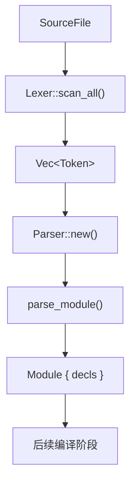

# SYX 编译器 - 语法分析文档

> **现状对齐：** SYX **117.0** · Phase **139** · `syx-cache-v1` · 许可证 [Apache-2.0](../LICENSE)  
> 实现状态 SSOT：[books/shared/implementation-status.md](../books/shared/implementation-status.md) · 文档索引：[README.md](./README.md)

## 1. 概述

语法分析器（Parser）是 SYX 编译器流水线的第二阶段，将 `syx-lexer` 产出的 `Token` 序列转换为抽象语法树（AST）。

当前实现位于 **`crates/syx-parser/`**，采用 **递归下降（Recursive Descent）** 解析声明与语句，配合 **优先级爬升（Precedence Climbing）** 解析表达式。AST 节点定义在 **`crates/syx-ast/`**。

- 入口：`Parser::parse(source: SourceFile) -> SyxResult<Module>`
- 内部流程：词法扫描 → `parse_module()` → 顶层声明列表
- 依赖：`syx-lexer`、`syx-ast`、`syx-diagnostics`、`smol_str`

## 2. 架构

### 2.1 解析流水线



### 2.2 Parser 结构体

```rust
// crates/syx-parser/src/lib.rs
pub struct Parser {
    source: SourceFile,
    tokens: Vec<Token>,
    current: usize,
}
```

Parser 不持有独立的错误恢复器或格式化器；错误通过 `SyxDiagnostic`（诊断码 **P001**）直接返回。

### 2.3 解析策略分层

```
                    parse_module()
                         │
              ┌──────────┴──────────┐
              │    parse_decl()     │  ← 递归下降（顶层/成员声明）
              └──────────┬──────────┘
                         │
         ┌───────────────┼───────────────┐
         │               │               │
   parse_function   parse_class    parse_protocol ...
         │               │
         └───────┬───────┘
                 │
           parse_block_stmts()
                 │
            parse_stmt()          ← 递归下降（语句分发）
                 │
            parse_expr()
                 │
         parse_precedence(0)      ← 优先级爬升（中缀运算符）
                 │
            parse_unary()
                 │
            parse_postfix()        ← 后缀：调用、成员、可选链、下标
                 │
            parse_primary()        ← 字面量、标识符、括号、数组、字典
```

### 2.4 换行处理

SYX 以换行作为语句分隔符。Parser 通过以下机制处理 `TokenKind::Newline`：

- `skip_newlines()`：前进 `current` 跳过连续换行
- `peek_index()`：返回下一个非换行 Token 的索引
- `peek()`：基于 `peek_index()` 查看当前有效 Token

块体解析（函数体、类体等）在每条语句/成员之间调用 `skip_newlines()`。

## 3. AST 节点（syx-ast）

AST 定义于 `crates/syx-ast/src/lib.rs`。

### 3.1 Module — 编译单元

```rust
pub struct Module {
    pub name: SmolStr,      // 当前固定为 "main"
    pub decls: Vec<Decl>,   // 顶层声明列表
}
```

### 3.2 Decl — 顶层/成员声明

```rust
pub enum Decl {
    Function {
        span: Span,
        access: AccessLevel,
        name: SmolStr,
        params: Vec<Param>,
        return_type: Option<TypeExpr>,
        effect: Option<FunctionEffect>,  // Pure | Io
        body: Vec<Stmt>,
        is_async: bool,
    },
    Import { span, module },
    Class { span, access, name, members: Vec<Decl> },
    Struct { span, access, name, fields: Vec<(SmolStr, TypeExpr)> },
    Protocol { span, name, methods: Vec<Decl> },
    VarGlobal { span, access, mutable, name, ty, init },
    Extension { span, type_name, methods: Vec<Decl> },
    DataClass { span, access, name, fields: Vec<(SmolStr, TypeExpr)> },
    SealedClass { span, access, name, variants: Vec<(SmolStr, Vec<(SmolStr, TypeExpr)>)> },
    Actor { span, access, name, members: Vec<Decl> },
}
```

### 3.3 Stmt — 语句

```rust
pub enum Stmt {
    Expr { span, expr },
    VarDecl { span, mutable, name, ty, init },
    Return { span, value },
    If { span, condition, then_branch, else_branch },
    IfLet { span, name, pattern, body, else_branch },
    GuardLet { span, name, pattern, body, else_branch },
    While { span, condition, body },
    ForIn { span, name, iterable, body },
    Block { span, stmts },
    Break { span },
    Continue { span },
    Try { span, body, catch_name, catch_body },
    Switch { span, subject, cases, default },
    Print { span, expr },   // print(...) 语法糖
}
```

### 3.4 Expr — 表达式

```rust
pub enum Expr {
    Literal { span, value: Literal },
    Ident { span, name },
    Binary { span, left, op: BinOp, right },
    Unary { span, op: UnaryOp, expr },
    Call { span, callee, args },
    Member { span, object, name },
    Index { span, object, index },
    Assign { span, name, value },
    Group { span, expr },
    Array { span, elements },
    Await { span, expr },
    OptionalChain { span, object, name },
    ForceUnwrap { span, expr },
    HalfOpenRange { span, start, end },       // switch 范围模式
    VariantPattern { span, variant, binding }, // switch 变体模式
}
```

### 3.5 辅助类型

```rust
pub enum AccessLevel { Public, Internal, Private }
pub enum FunctionEffect { Pure, Io }
pub enum BinOp { Add, Sub, Mul, Div, Mod, Eq, NotEq, Lt, LtEq, Gt, GtEq, And, Or, NilCoalesce }
pub enum UnaryOp { Neg, Not, Try }

pub struct Param {
    pub name: SmolStr,
    pub ty: Option<TypeExpr>,
    pub default: Option<Expr>,
}

pub enum TypeExpr {
    Named { name, generics: Vec<TypeExpr> },
    Optional(Box<TypeExpr>),
    Array(Box<TypeExpr>),
    Dictionary { key: Box<TypeExpr>, value: Box<TypeExpr> },
    Function { params: Vec<TypeExpr>, returns: Option<Box<TypeExpr>> },
    Void,
}

pub enum Literal {
    Integer(i64), Double(f64), String(String),
    Interpolated(Vec<StringPart>),
    Regex(String),
    Dict(Vec<(String, Expr)>),
    Bool(bool), Nil,
}
```

## 4. 详细设计

### 4.1 模块解析

```rust
pub fn parse(source: SourceFile) -> SyxResult<Module> {
    let tokens = Lexer::new(source.clone()).scan_all()?;
    let mut parser = Self::new(source, tokens);
    parser.parse_module()
}

fn parse_module(&mut self) -> SyxResult<Module> {
    let mut decls = Vec::new();
    while !self.is_at_end() {
        self.skip_newlines();
        if self.is_at_end() { break; }
        decls.push(self.parse_decl()?);
    }
    Ok(Module { name: SmolStr::new("main"), decls })
}
```

> **对应 BNF：** §5.0（元符号）、§5.1（`<module>`）

### 4.2 声明解析 `parse_decl()`

根据前瞻 Token 分发：

| 前瞻 Token | 解析方法 | 产出 Decl |
|------------|----------|-----------|
| `import` | `parse_import()` | `Decl::Import` |
| `public`/`internal`/`private` | `parse_access()` + `parse_decl_with_access()` | 带访问级别的声明 |
| `func` | `parse_function(..., false)` | `Decl::Function` |
| `async` | 消费后要求 `func` | `Decl::Function { is_async: true }` |
| `class` | `parse_class()` | `Decl::Class` |
| `data` | 要求 `class` → `parse_data_class()` | `Decl::DataClass` |
| `sealed` | 要求 `class` → `parse_sealed_class()` | `Decl::SealedClass` |
| `extension` | `parse_extension()` | `Decl::Extension` |
| `actor` | `parse_actor()` | `Decl::Actor` |
| `struct` | `parse_struct()` | `Decl::Struct` |
| `protocol` | `parse_protocol()` | `Decl::Protocol` |
| `var`/`let` | `parse_global_var()` | `Decl::VarGlobal` |

#### 函数声明

```syx
async func fetch(url: String) -> Data requires Pure {
    return await load(url)
}
```

解析步骤：`name` → `(` `params` `)` → 可选 `-> return_type` → 可选 `requires Pure|IO` → `{` `body` `}`

#### Data Class

```syx
data class Point(x: Int, y: Int)
```

主构造器参数列表：`name: Type, ...`，无方法体。

#### Sealed Class

```syx
sealed class Result {
    success(value: String)
    failure(code: Int)
}
```

变体名后可跟 `(field: Type, ...)` 字段列表。

#### Extension

```syx
extension Int {
    func doubled() -> Int {
        return self * 2
    }
}
```

解析目标为**单一标识符**类型名（如 `Int`、`String`），由 `consume_identifier` 读取，**不是**完整 `<type>` 表达式；方法体内部递归 `parse_function`。

#### Protocol

```syx
protocol Drawable {
    func draw() {
    }
}
```

协议体方法由 `parse_function` 解析，**须包含 `{ }` 方法体**（可为空块）；当前 parser 不支持仅签名、无方法体的声明。

#### Actor

```syx
actor Counter {
    var count: Int = 0
    func increment() { ... }
}
```

Actor 体递归解析成员声明（`parse_decl`）。

#### Parser 入口与产出对照

| 解析函数 | 产出类型 | 说明 |
|----------|----------|------|
| `parse_module` | `Module` | 顶层声明列表 |
| `parse_decl` | `Decl` | 按前瞻 Token 分发 |
| `parse_import` | `Decl::Import` | |
| `parse_function` | `Decl::Function` | 亦用于 extension/protocol 成员 |
| `parse_data_class` | `Decl::DataClass` | 括号字段列表，无 `{ }` |
| `parse_sealed_class` | `Decl::SealedClass` | 变体 + 可选关联字段 |
| `parse_extension` | `Decl::Extension` | 目标为 `<ident>` |
| `parse_protocol` | `Decl::Protocol` | |
| `parse_actor` | `Decl::Actor` | 成员递归 `parse_decl` |
| `parse_class` | `Decl::Class` | 成员递归 `parse_decl` |
| `parse_struct` | `Decl::Struct` | 花括号字段列表 |
| `parse_global_var` | `Decl::VarGlobal` | 顶层 `var`/`let` |
| `parse_params` | `Vec<Param>` | 含可选类型与默认值 |

> **对应 BNF：** §5.1（`<decl>`）、§5.2（`<function>`、`<param>`）

### 4.3 语句解析 `parse_stmt()`

| 前瞻 Token | 解析方法 | 产出 Stmt |
|------------|----------|-----------|
| `var`/`let` | `parse_var_decl()` | `Stmt::VarDecl` |
| `return` | `parse_return()` | `Stmt::Return` |
| `if` | `parse_if_or_if_let()` | `Stmt::If` 或 `Stmt::IfLet` |
| `guard` | `parse_guard_let()` | `Stmt::GuardLet` |
| `switch` | `parse_switch()` | `Stmt::Switch` |
| `while` | `parse_while()` | `Stmt::While` |
| `for` | `parse_for_in()` | `Stmt::ForIn` |
| `try` | `parse_try()` | `Stmt::Try` |
| `break`/`continue` | 直接消费 | `Stmt::Break`/`Continue` |
| `{` | `parse_block_stmts()` | `Stmt::Block` |
| 表达式起始 | `parse_expr()` | `Stmt::Print`（`print` 调用）或 `Stmt::Expr` |

#### For-In 循环

```syx
for item in collection {
    print(item)
}
```

产出 `Stmt::ForIn { name, iterable, body }`。

#### Try/Catch

```syx
try {
    risky()
} catch (e) {
    print(e)
}
```

产出 `Stmt::Try { body, catch_name, catch_body }`。`catch` 后要求 `(identifier)`。

#### If / If Let

```syx
if (x > 0) {
    ...
} else {
    ...
}

if let value = optional {
    ...
}
```

- 普通 `if`：条件表达式须包在 `()` 中
- `if let`：`if let name = pattern { ... }` 可选 `else { ... }`

#### Guard Let

```syx
guard let x = opt else {
    return
}
{
    use(x)
}
```

先解析 `else` 分支块，再解析主体块。

#### Switch 与模式

```syx
switch value {
    case 1:
        print("one")
    case 2..<5:
        print("few")
    case .success(let msg):
        print(msg)
    default:
        print("other")
}
```

`parse_switch_pattern()` 支持三种模式：

| 模式形式 | AST 节点 | 示例 |
|----------|----------|------|
| 整数字面量 | `Expr::Literal { Integer }` | `case 1:` |
| 半开范围 | `Expr::HalfOpenRange { start, end }` | `case 2..<5:` |
| 变体绑定 | `Expr::VariantPattern { variant, binding }` | `case .foo(let x):` |
| 任意表达式 | 递归 `parse_expr()` | `case someExpr:` |

| 解析函数 | 产出类型 |
|----------|----------|
| `parse_stmt` | `Stmt` |
| `parse_var_decl` | `Stmt::VarDecl` |
| `parse_return` | `Stmt::Return` |
| `parse_if_or_if_let` | `Stmt::If` / `Stmt::IfLet` |
| `parse_guard_let` | `Stmt::GuardLet` |
| `parse_switch` | `Stmt::Switch` |
| `parse_switch_pattern` | `Expr`（模式节点） |
| `parse_while` | `Stmt::While` |
| `parse_try` | `Stmt::Try` |
| `parse_for_in` | `Stmt::ForIn` |
| `parse_block_stmts` | `Vec<Stmt>` |

> **对应 BNF：** §5.4（`<stmt>`）、§5.5（`<switch-pattern>`）

### 4.4 表达式解析

#### 优先级爬升 `parse_precedence()`

```rust
fn parse_precedence(&mut self, min_prec: u8) -> SyxResult<Expr> {
    let mut left = self.parse_unary()?;
    loop {
        let Some((op, prec)) = infix_op(&self.peek().kind) else { break };
        if prec < min_prec { break; }
        self.advance();
        let right = self.parse_precedence(prec + 1)?;
        left = Expr::Binary { span, left: Box::new(left), op, right: Box::new(right) };
    }
    Ok(left)
}
```

`infix_op()` 优先级表：

| 优先级 | 运算符 | BinOp |
|--------|--------|-------|
| 1 | `\|\|` | `Or` |
| 2 | `&&` | `And` |
| 3 | `==` `!=` | `Eq` `NotEq` |
| 4 | `<` `<=` `>` `>=` | `Lt` `LtEq` `Gt` `GtEq` |
| 5 | `+` `-` | `Add` `Sub` |
| 6 | `*` `/` `%` | `Mul` `Div` `Mod` |
| 7 | `??` | `NilCoalesce` |

#### 一元表达式 `parse_unary()`

| 前缀 | UnaryOp / 节点 |
|------|----------------|
| `await` | `Expr::Await` |
| `try` | `Expr::Unary { op: Try }` |
| `-` | `Expr::Unary { op: Neg }` |
| `!` | `Expr::Unary { op: Not }` |

#### 后缀表达式 `parse_postfix()`

循环处理后缀操作，直至不匹配：

| 后缀 | AST 节点 |
|------|----------|
| `(...)` | `Expr::Call` |
| `.name` | `Expr::Member` |
| `?.name` | `Expr::OptionalChain` |
| `!` | `Expr::ForceUnwrap` |
| `?` | `Expr::Unary { op: Try }`（与前缀 `try expr` 同节点；`syx format` 规范形为后缀 `expr?`） |
| `[index]` | `Expr::Index` |

标识符后的 `=` 在 postfix **首轮**检测，处理为 `Expr::Assign`（**仅**简单标识符左值 `ident = expr`，不支持 `obj.field = v` 等复合左值）。

#### 半开区间表达式

整数后跟 `..<` 与结束整数，在 `parse_primary()` 与 `parse_switch_pattern()` 中均可出现：

```syx
let r = 1..<10        // Expr::HalfOpenRange（表达式位置）
switch n {
    case 1..<10:       // 同上，用于 switch case
        ...
}
```

#### 可选链

```syx
user?.name
```

词法产出 `Question` + `Dot` + `Identifier`；parser 识别 `?.` 组合，生成 `Expr::OptionalChain { object, name }`。

#### 主表达式 `parse_primary()`

| Token | AST |
|-------|-----|
| 字面量 Token | `Expr::Literal` |
| `identifier` | `Expr::Ident` |
| `(` expr `)` | `Expr::Group` |
| `[e1, e2, ...]` | `Expr::Array` |
| `{ "k": v, ... }` | `Expr::Literal { Dict }` |
| `integer ..< integer` | `Expr::HalfOpenRange` |

#### 字典字面量 `parse_dict_literal()`

```syx
let map = { "name": "SYX", "version": 1 }
```

键须为**字符串字面量** `"key"`；值通过 `parse_expr()` 解析。产出 `Literal::Dict(entries)`。

| 解析函数 | 产出类型 |
|----------|----------|
| `parse_expr` / `parse_precedence` | `Expr` |
| `parse_unary` | `Expr` |
| `parse_postfix` | `Expr` |
| `parse_primary` | `Expr` |
| `parse_dict_literal` | `Expr::Literal { Dict }` |
| `parse_embedded_expr` | `Expr`（插值子表达式） |
| `parse_args` | `Vec<Expr>` |

> **对应 BNF：** §5.6（`<expr>`）、§5.7（`<literal>`）、§5.8（终结符映射）

#### 插值字符串二次解析

`TokenKind::InterpolatedString` 中每个 `InterpPart::Expr` 的原始文本，由 `parse_embedded_expr()` 创建子 Parser 重新解析为 `Expr`：

```rust
fn parse_embedded_expr(&self, raw: &str) -> SyxResult<Expr> {
    let source = SourceFile::new("<interp>", raw);
    let tokens = Lexer::new(source.clone()).scan_all()?;
    let mut parser = Parser::new(source, tokens);
    parser.parse_expr()
}
```

### 4.5 类型解析 `parse_type()`

```syx
Int
String?
Array<Int>
Dict<String, Int>
[Int]
(Int) -> Int
some Equatable
any Protocol
```

```rust
// Named { name, generics } — 泛型用 <T1, T2> 包裹
// 后缀 ? → Optional(Box<TypeExpr>)
// [T] → Array；[K: V] → Dictionary
// (params) -> Ret → Function；some/any → OpaqueSome / OpaqueAny
// (T, U) / (x: T, y: U) → Tuple
```

`parse_type()` 产出 `TypeExpr`：`Named`（含泛型）、`Optional`、`Array`、`Dictionary`、`Function`、`OpaqueSome` / `OpaqueAny`、`Tuple` 等。例如 `Array<Int>` 亦可写作 `Named { name: "Array", generics: […] }`；字面 `[Int]` 直接构造 `TypeExpr::Array`。

**格式化（W832）：** AST formatter 印 Optional / OpaqueSome / OpaqueAny / Function / Reference、oversized `BigInt`、插值字符串 `Interpolated`、正则字面量 `Regex`（`/pattern/`；Literal 残面收口）；CST 子集（opt-in `SYX_FMT_CST`）加深为 1..N 个 `func name([Ident[: Ident[<Named(, Named)*>][?]| &Ident[?]| &mut Ident[?]| &'a Ident[?]| &'a mut Ident[?]…]) [-> Ident[<NestedNamed>][?]| &Ident[?]| &mut Ident[?]| &'a Ident[?]| &'a mut Ident[?]] {…}`（可选 Named / Optional Named / 嵌套·多参 Named generic / Amp 族[`?`] 类型注解与可选 `-> Ident[<NestedNamed>][?]| &Ident[?]| &mut Ident[?]| &'a Ident[?]| &'a mut Ident[?]` 返回；空参与 bare 仍合法）与模块顶层 simple stmt 交错，各 body 0..N 条同形 simple；默认仍 AST；仍拒 multi Named generic·Function 返回 / Amp·Function 作 generic 实参 / effect / 纯 stmt 无 func / `lazy computed var` 等 Decl 拒面（M0-A02 F001）。

> **对应 BNF：** §5.3（`<type>`）

### 4.6 print 语法糖

当表达式语句为 `print(...)` 调用时，parser 将其提升为 `Stmt::Print`：

```rust
fn is_print_call(expr: &Expr) -> bool {
    matches!(expr, Expr::Call { callee, .. }
        if matches!(callee.as_ref(), Expr::Ident { name, .. } if name == "print"))
}
```

> **对应 BNF：** §5.4（`<expr-stmt>` 注释）

## 5. 完整语法规则（BNF）

以下 BNF 与 `crates/syx-parser/src/lib.rs` 中递归下降 + 优先级爬升实现**一一对应**，为 SYX 语法的权威规范。终结符命名与 [1_LexicalAnalysis.md](1_LexicalAnalysis.md) 中的 `TokenKind` 一致。速查示例见 [8_QuickReference.md](8_QuickReference.md)。

### 5.0 元符号与约定

| 符号 | 含义 |
|------|------|
| `{ ... }` | 零次或多次重复 |
| `[ ... ]` | 可选（0 或 1 次） |
| `( ... )` | 分组；或 BNF 中的字面括号 Token |
| `\|` | 择一 |
| `<ident>` | 标识符 Token（`TokenKind::Identifier`） |
| `<integer>` / `<double>` / `<string>` | 对应字面量 Token |

**换行与空白：** Parser 通过 `skip_newlines()` 与 `peek_index()` 跳过 `TokenKind::Newline`，换行在声明与语句之间等价于分隔符；块内语句以 `}` 结束，不要求分号。

**表达式语句：** `<expr-stmt>` 后可跟可选 `;`。若 `<expr>` 为对标识符 `print` 的调用，降级为 `Stmt::Print`（见 §4.6）。

**语句 vs 表达式 `try`：** 语句级 `try { } catch (id) { }` 由 `parse_try()` 解析；表达式级前缀 `try expr` 由 `parse_unary()` 解析为 `UnaryOp::Try`。

**`return` 与 `{`：** `check_expr_start()` 已含 `LBrace`，`return { "k": v }` 可正确解析（见 §11.4）。

### 5.1 模块与声明

```bnf
<module>       ::= { <decl> }

<access>       ::= "public" | "internal" | "private"

<decl>         ::= "import" <ident>
                 | <access>? <function>
                 | <access>? "class" <ident> "{" { <decl> } "}"
                 | <access>? "data" "class" <ident> "(" [ <field-list> ] ")"
                 | <access>? "sealed" "class" <ident> "{" { <variant> } "}"
                 | <access>? "struct" <ident> "{" { <field> } "}"
                 | <access>? ( "var" | "let" ) <ident> [ ":" <type> ] [ "=" <expr> ]
                 | "extension" <ident> "{" { <function> } "}"
                 | "protocol" <ident> "{" { <function> } "}"
                 | <access>? "actor" <ident> "{" { <decl> } "}"
```

说明：

- `extension` 目标为**单一** `<ident>`（如 `Int`），不是完整 `<type>` 表达式。
- `data class` 使用圆括号字段列表，**无** `{ }` 方法体。
- `sealed class` 变体**无** `case` 关键字；变体名后直接可选关联值元组。
- `class` / `actor` 成员递归为 `<decl>`；`protocol` / `extension` 成员仅为 `<function>`。

### 5.2 函数、参数与字段

```bnf
<function>     ::= [ "async" ] "func" <ident> "(" [ <param-list> ] ")"
                   [ "->" <type> ] [ "requires" ( "Pure" | "IO" ) ] "{" { <stmt> } "}"

<param-list>   ::= <param> { "," <param> }
<param>        ::= <ident> [ ":" <type> ] [ "=" <expr> ]

<field-list>   ::= <field> { "," <field> }
<field>        ::= <ident> ":" <type>

<variant>      ::= <ident> [ "(" [ <field-list> ] ")" ]
```

### 5.3 类型

Parser 实际产出仅为 `TypeExpr::Named` 与 `TypeExpr::Optional`：

```bnf
<type>         ::= <named-type> [ "?" ]
<named-type>   ::= <ident> [ "<" <type> { "," <type> } ">" ]
```

`Array<Int>`、`Dict<String, Int>` 等均解析为带泛型实参的 `<named-type>`，而非 AST 预留的 `Array` / `Dictionary` 专用变体。

### 5.4 语句

```bnf
<stmt>         ::= ( "var" | "let" ) <ident> [ ":" <type> ] [ "=" <expr> ]
                 | "return" [ <expr> ]
                 | "if" "let" <ident> "=" <expr> "{" { <stmt> } "}" [ "else" "{" { <stmt> } "}" ]
                 | "if" "(" <expr> ")" "{" { <stmt> } "}" [ "else" "{" { <stmt> } "}" ]
                 | "guard" "let" <ident> "=" <expr> "else" "{" { <stmt> } "}" "{" { <stmt> } "}"
                 | "switch" <expr> "{" { <case> } [ <default> ] "}"
                 | "while" "(" <expr> ")" "{" { <stmt> } "}"
                 | "for" <ident> "in" <expr> "{" { <stmt> } "}"
                 | "try" "{" { <stmt> } "}" "catch" "(" <ident> ")" "{" { <stmt> } "}"
                 | "break"
                 | "continue"
                 | "{" { <stmt> } "}"
                 | <expr-stmt>

<case>         ::= "case" <switch-pattern> ":" { <stmt> }
<default>      ::= "default" ":" { <stmt> }

<expr-stmt>    ::= <expr> [ ";" ]
                 (* 若 <expr> 为 print(...) 调用 → AST: Stmt::Print *)
```

### 5.5 Switch 模式

```bnf
<switch-pattern> ::= <integer>
                 | <integer> "..<" <integer>
                 | "." <ident> [ "(" "let" <ident> ")" ]
                 | <expr>
```

| 形式 | AST |
|------|-----|
| `42` | `Expr::Literal { Integer }` |
| `1..<10` | `Expr::HalfOpenRange` |
| `.ok(let x)` | `Expr::VariantPattern` |
| 其它 | 普通 `Expr` |

### 5.6 表达式

与 §4.4 优先级表一致；中缀运算符左结合，优先级数字越大绑定越紧（`parse_precedence(min_prec)`）。

```bnf
<expr>           ::= <binary-expr>                    (* min_prec = 0 *)

<binary-expr>    ::= <unary-expr> { <bin-op> <unary-expr> }
<bin-op>         ::= "||" | "&&" | "==" | "!="
                 | "<" | "<=" | ">" | ">="
                 | "+" | "-" | "*" | "/" | "%" | "??"

<unary-expr>     ::= ( "await" | "try" | "-" | "!" ) <unary-expr>
                 | <postfix-expr>

<postfix-expr>   ::= <primary> { <postfix-op> }
                   | <ident> "=" <expr>               (* 仅首轮：Assign *)

<postfix-op>     ::= "(" [ <arg-list> ] ")"
                 | "." <ident>
                 | "?." <ident>
                 | "!"
                 | "[" <expr> "]"

<primary>        ::= <literal>
                 | <ident>
                 | "(" <expr> ")"
                 | "[" [ <expr-list> ] "]"
                 | "{" [ <dict-entry-list> ] "}"
                 | <integer> "..<" <integer>

<arg-list>       ::= <expr> { "," <expr> }
<expr-list>      ::= <expr> { "," <expr> }

<dict-entry-list> ::= <dict-key> ":" <expr> { "," <dict-key> ":" <expr> }
<dict-key>       ::= <string>
```

**优先级（`infix_op`，数值越大越紧）：**

| 级 | 运算符 | BinOp |
|----|--------|-------|
| 1 | `\|\|` | Or |
| 2 | `&&` | And |
| 3 | `==` `!=` | Eq, NotEq |
| 4 | `<` `<=` `>` `>=` | Lt, LtEq, Gt, GtEq |
| 5 | `+` `-` | Add, Sub |
| 6 | `*` `/` `%` | Mul, Div, Mod |
| 7 | `??` | NilCoalesce |

### 5.7 字面量

```bnf
<literal>      ::= <integer>
                 | <double>
                 | <string>
                 | <interpolated-string>
                 | <regex>
                 | "true" | "false"
                 | "nil"
```

| 形式 | TokenKind / 说明 |
|------|------------------|
| 整型 | `Integer` |
| 浮点 | `Double` |
| 字符串 | `String` |
| `"Hello \(name)"` | `InterpolatedString`（嵌入表达式二次 `parse_expr`） |
| `/pattern/` | `Regex` |
| 布尔 / 空 | `Bool` / `Nil` |

### 5.8 终结符与 Token 映射

| 源码文本 | TokenKind | 备注 |
|----------|-----------|------|
| `..<` | `DotDotLess` | 半开区间 |
| `??` | `NilCoalesce` | 空合并 |
| `?.` | `Question` + `Dot` | 可选链，parser 合并识别 |
| `->` | `Arrow` | 返回类型 |
| `requires` | `Requires` | 效果约束 |
| `Pure` / `IO` | `Pure` / `Io` | 效果枚举 |
| `/.../` | `Regex` | 正则字面量 |
| `import` | `Import` | 模块导入 |

完整关键字与运算符列表见 [1_LexicalAnalysis.md](1_LexicalAnalysis.md)。

## 6. 错误处理

语法错误统一使用诊断码 **P001**：

```rust
fn error<T>(&self, message: &str) -> SyxResult<T> {
    Err(SyxDiagnostic::error(message)
        .with_code("P001")
        .with_span(&self.source, self.peek().span, "here"))
}

fn error_at<T>(&self, token: Token, message: &str) -> SyxResult<T> {
    Err(SyxDiagnostic::error(message)
        .with_code("P001")
        .with_span(&self.source, token.span, "here"))
}
```

常见 P001 场景：

| 场景 | 典型消息 |
|------|----------|
| 非声明起始 | `Expected declaration` |
| 缺少 `func` | `Expected 'func' after async` |
| 缺少括号/花括号 | `Expected '(' after function name` |
| 缺少类型名 | `Expected type name` |
| 非表达式起始 | `Expected expression` |
| 字典键非法 | `Expected string key in dictionary literal` |
| 效果约束非法 | `Expected 'Pure' or 'IO' after requires` |

当前实现 **不包含** 错误恢复（error recovery）：遇到 P001 后立即返回 `Err`，不尝试同步继续解析。

### 6.1 Token 辅助方法

```rust
fn consume(&mut self, kind: TokenKind, message: &str) -> SyxResult<&Token>
fn consume_identifier(&mut self, message: &str) -> SyxResult<SmolStr>
fn match_kind(&mut self, kind: TokenKind) -> bool
fn check(&self, kind: TokenKind) -> bool
fn check_expr_start(&self) -> bool
fn advance(&mut self) -> &Token
fn peek(&self) -> &Token
fn skip_newlines(&mut self)
```

## 7. AST 访问者模式

`syx-ast` 提供 `ExprVisitor<T>` trait，用于遍历表达式树：

```rust
pub trait ExprVisitor<T> {
    fn visit_literal(&mut self, value: &Literal) -> T;
    fn visit_ident(&mut self, name: &SmolStr) -> T;
    fn visit_binary(&mut self, left: &Expr, op: BinOp, right: &Expr) -> T;
    // ...
    fn walk_expr(&mut self, expr: &Expr) -> T { ... }
}
```

`Await`、`OptionalChain`、`ForceUnwrap` 等节点通过 `visit_group` 委托；`HalfOpenRange` 与 `VariantPattern` 在默认 `walk_expr` 中回退为 `visit_literal(Nil)`。

## 8. 完整示例

### 8.1 输入源代码

```syx
import utils

data class User(name: String, age: Int)

sealed class Response {
    ok(data: String)
    err(code: Int)
}

protocol Greeter {
    func greet(name: String) -> String {
        return name
    }
}

extension String {
    func shout() -> String {
        return self + "!"
    }
}

async func main() -> Int requires IO {
    let users = { "alice": User("Alice", 30) }
    let count = 3
    for key in users {
        let name = users[key]?.name ?? "unknown"
        print(name)
    }
    try {
        risky()
    } catch (e) {
        print(e)
    }
    switch count {
        case 0:
            print("empty")
        case 1..<10:
            print("few")
        default:
            print("many")
    }
    return 0
}
```

### 8.2 解析调用

```rust
use syx_diagnostics::SourceFile;
use syx_parser::Parser;

let source = SourceFile::new("app.sy", SOURCE);
let module = Parser::parse(source)?;
// module.decls 包含 Import、DataClass、SealedClass、Protocol、
// Extension、Function 等 Decl 变体
```

### 8.3 产出 AST 结构（示意）

```
Module { name: "main" }
├── Decl::Import { module: "utils" }
├── Decl::DataClass { name: "User", fields: [(name, String), (age, Int)] }
├── Decl::SealedClass { name: "Response", variants: [ok, err] }
├── Decl::Protocol { name: "Greeter", methods: [greet] }
├── Decl::Extension { type_name: "String", methods: [shout] }
└── Decl::Function { name: "main", is_async: true, effect: Io, body: [...] }
    ├── Stmt::VarDecl { name: "users", init: DictLiteral }
    ├── Stmt::VarDecl { name: "count", init: Literal(3) }
    ├── Stmt::ForIn { name: "key", iterable: Ident("users") }
    │   └── Stmt::VarDecl { init: OptionalChain + NilCoalesce }
    ├── Stmt::Try { catch_name: "e" }
    └── Stmt::Switch { subject: Ident("count"), cases: [0, 1..<10], default: ... }
```

## 9. 测试

单元测试位于 `crates/syx-parser/src/lib.rs` 的 `#[cfg(test)]` 模块：

| 测试 | 验证内容 |
|------|----------|
| `parses_function_and_print` | 函数声明与 `print` 调用 |
| `parses_hello_world` | 标准 Hello World 程序 |
| `parses_for_in_loop` | `for i in items` 循环 |

运行测试：

```bash
cargo test -p syx-parser
```

## 10. Crate 依赖关系

```
syx-parser
├── syx-lexer        (Lexer, Token, TokenKind)
├── syx-ast          (Module, Decl, Stmt, Expr, TypeExpr, ...)
├── syx-diagnostics  (SourceFile, Span, SyxDiagnostic, SyxResult)
└── smol_str         (SmolStr)
```

上游：`syx-lexer` 提供 Token 流。  
下游：编译器后续阶段（类型检查、代码生成等）消费 `Module` AST。

## 11. 当前限制

§11.1 所列语法已在当前工具链实现（Parser → Semantic → Mono → CodeGen → VM）。集成测试见 `p2_integration.rs`（18 项）、`p4_*.sy`、`p5_integration.rs`（5 项）与 `p5_mir_parity.rs`（MIR 与 p4 对等 5 项）。

### 11.1 已实现

| 类别 | 特性 | 测试 / 说明 |
|------|------|-------------|
| Parser 修复 | 字典 ident 键、`return { }`、`public protocol/import`、`+=`、`self` | `p2_limits_parser.sy` |
| 语句 | `throw expr`、`repeat { } while (cond)` | `p2_limits_stmt.sy` |
| 声明 | `enum` 关联值、`init`/`deinit`、`struct`/`class`/`actor`、`class: Protocol` | `p2_enum.sy`、`fixtures/lang/enum_associated.sy`、`p3_class_struct.sy`、`p4_protocol_witness.sy` |
| 调用 / 模块 | 命名实参、`import a.b`、`import x as y` | `p2_named_args.sy`、`p3_import_alias.sy` |
| 泛型 / 属性 | 调用点单态化（`syx-mono`）、`where` 实参校验 **S010**、S009 协议名 lint、`@Main`、`@available(iOS 13)` | `p4_generics.sy`、`p5_generics_where_fail.sy`、`p3_attributes.sy` |
| 闭包 / HOF | 多捕获、`MakeClosure(N)`、`Array.map/filter/reduce` | `p4_closures_capture.sy`、`p4_hof.sy` |
| class / actor | 隐式 `self`、实例字段、按 `__actor_id` 加锁、`ActorCall`、跨 actor 字段 **S008** | `fixtures/parity/actor_isolation.sy`、`p5_actor_s008.sy` |
| protocol / for-in | witness 表、`for-in` 读 `__witness_Iterator_next` | `p4_protocol_witness.sy`、`p5_for_in_witness.sy` |
| enum | 关联值 switch、模式感知穷尽 **S007** | `fixtures/lang/enum_associated.sy`、`p5_enum_exhaustive.sy` |
| async | 多 `await`、`AwaitPoll` 指令 | `p5_async_multi.sy` |
| 范围 / 赋值 | `(1..<10).contains(n)`、复合赋值、`ObjectSet`/`ArraySet` | `p3_range.sy` |
| MIR | 混合编译（type shell + MIR 函数体）、扩展 MirOp、`SYX_USE_MIR=1` | `p5_mir_parity.rs` |

### 11.2 仍有限制（MVP）

| 特性 | 现状 |
|------|------|
| 泛型 | 单态化按实参类型命名；无完整 trait 约束推断（仅有 **S010** 显式 conformance 校验） |
| async | `AwaitPoll` 仍为 blocking poll MVP |
| native / wasm | LLVM/WASM 后端对新增 MirOp 为 stub，非全指令集 |

### 11.3 仍未实现

| 特性 | 说明 |
|------|------|
| 顶层 `init`/`deinit` | 模块级解析报 **P001**（仅 class/actor 内） |
| `case`/`default` 于 switch 外 | 仍 P001 |
| 完整 Swift 并发 / 所有权 | 见 [7_FeatureImplementationPriority.md](7_FeatureImplementationPriority.md) P3+ |

### 11.4 `check_expr_start`（`parse_return` 专用）

**已含：** `Integer`、`Double`、`String`、`InterpolatedString`、`Regex`、`Bool`、`Nil`、`Identifier`、`LParen`、`LBracket`、`LBrace`、`Minus`、`Bang`、`Await`、`Try`、`Throw`。

**说明：** `return { "k": v }` 现已因含 `LBrace` 而**可**解析为返回字典；`check_expr_start` 与 `parse_expr` 行为一致。

随实现演进，§5 BNF 与本节应同步更新。
