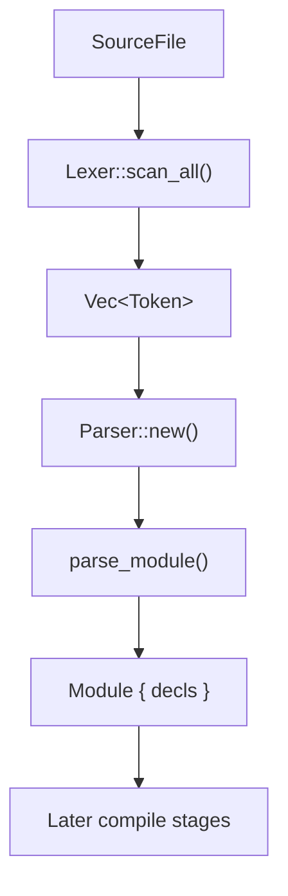

# SYX Compiler — Syntax Analysis

[简体中文](./zh/2_SyntaxAnalysis.zh-CN.md)

## 1. Overview

The parser is the second stage of the SYX compiler pipeline. It converts the `Token` stream from `syx-lexer` into an abstract syntax tree (AST).

The current implementation lives in **`crates/syx-parser/`**, using **recursive descent** for declarations and statements, plus **precedence climbing** for expressions. AST nodes are defined in **`crates/syx-ast/`**.

- Entry: `Parser::parse(source: SourceFile) -> SyxResult<Module>`
- Internal flow: lexical scan → `parse_module()` → top-level declaration list
- Dependencies: `syx-lexer`, `syx-ast`, `syx-diagnostics`, `smol_str`

## 2. Architecture

### 2.1 Parse pipeline



### 2.2 Parser struct

```rust
// crates/syx-parser/src/lib.rs
pub struct Parser {
    source: SourceFile,
    tokens: Vec<Token>,
    current: usize,
}
```

The parser has no separate error recovery or formatter; errors return directly as `SyxDiagnostic` (code **P001**).

### 2.3 Layered parse strategy

```
                    parse_module()
                         │
              ┌──────────┴──────────┐
              │    parse_decl()     │  ← recursive descent (top-level / member decls)
              └──────────┬──────────┘
                         │
         ┌───────────────┼───────────────┐
         │               │               │
   parse_function   parse_class    parse_protocol ...
         │               │
         └───────┬───────┘
                 │
           parse_block_stmts()
                 │
            parse_stmt()          ← recursive descent (statement dispatch)
                 │
            parse_expr()
                 │
         parse_precedence(0)      ← precedence climbing (infix operators)
                 │
            parse_unary()
                 │
            parse_postfix()        ← postfix: call, member, optional chain, subscript
                 │
            parse_primary()        ← literals, identifiers, parens, arrays, dicts
```

### 2.4 Newline handling

SYX uses newlines as statement separators. The parser handles `TokenKind::Newline` via:

- `skip_newlines()`: advance `current` past consecutive newlines
- `peek_index()`: index of the next non-newline token
- `peek()`: effective current token from `peek_index()`

Block bodies (function, class, etc.) call `skip_newlines()` between statements/members.

## 3. AST nodes (syx-ast)

The AST is defined in `crates/syx-ast/src/lib.rs`.

### 3.1 Module — compilation unit

```rust
pub struct Module {
    pub name: SmolStr,      // Currently fixed to "main"
    pub decls: Vec<Decl>,   // Top-level declarations
}
```

### 3.2 Decl — top-level / member declarations

```rust
pub enum Decl {
    Function {
        span: Span,
        access: AccessLevel,
        name: SmolStr,
        params: Vec<Param>,
        return_type: Option<TypeExpr>,
        effect: Option<FunctionEffect>,  // Pure | Io
        body: Vec<Stmt>,
        is_async: bool,
    },
    Import { span, module },
    Class { span, access, name, members: Vec<Decl> },
    Struct { span, access, name, fields: Vec<(SmolStr, TypeExpr)> },
    Protocol { span, name, methods: Vec<Decl> },
    VarGlobal { span, access, mutable, name, ty, init },
    Extension { span, type_name, methods: Vec<Decl> },
    DataClass { span, access, name, fields: Vec<(SmolStr, TypeExpr)> },
    SealedClass { span, access, name, variants: Vec<(SmolStr, Vec<(SmolStr, TypeExpr)>)> },
    Actor { span, access, name, members: Vec<Decl> },
}
```

### 3.3 Stmt — statements

```rust
pub enum Stmt {
    Expr { span, expr },
    VarDecl { span, mutable, name, ty, init },
    Return { span, value },
    If { span, condition, then_branch, else_branch },
    IfLet { span, name, pattern, body, else_branch },
    GuardLet { span, name, pattern, body, else_branch },
    While { span, condition, body },
    ForIn { span, name, iterable, body },
    Block { span, stmts },
    Break { span },
    Continue { span },
    Try { span, body, catch_name, catch_body },
    Switch { span, subject, cases, default },
    Print { span, expr },   // print(...) sugar
}
```

### 3.4 Expr — expressions

```rust
pub enum Expr {
    Literal { span, value: Literal },
    Ident { span, name },
    Binary { span, left, op: BinOp, right },
    Unary { span, op: UnaryOp, expr },
    Call { span, callee, args },
    Member { span, object, name },
    Index { span, object, index },
    Assign { span, name, value },
    Group { span, expr },
    Array { span, elements },
    Await { span, expr },
    OptionalChain { span, object, name },
    ForceUnwrap { span, expr },
    HalfOpenRange { span, start, end },       // switch range patterns
    VariantPattern { span, variant, binding }, // switch variant patterns
}
```

### 3.5 Auxiliary types

```rust
pub enum AccessLevel { Public, Internal, Private }
pub enum FunctionEffect { Pure, Io }
pub enum BinOp { Add, Sub, Mul, Div, Mod, Eq, NotEq, Lt, LtEq, Gt, GtEq, And, Or, NilCoalesce }
pub enum UnaryOp { Neg, Not, Try }

pub struct Param {
    pub name: SmolStr,
    pub ty: Option<TypeExpr>,
    pub default: Option<Expr>,
}

pub enum TypeExpr {
    Named { name, generics: Vec<TypeExpr> },
    Optional(Box<TypeExpr>),
    Array(Box<TypeExpr>),
    Dictionary { key: Box<TypeExpr>, value: Box<TypeExpr> },
    Function { params: Vec<TypeExpr>, returns: Option<Box<TypeExpr>> },
    Void,
}

pub enum Literal {
    Integer(i64), Double(f64), String(String),
    Interpolated(Vec<StringPart>),
    Regex(String),
    Dict(Vec<(String, Expr)>),
    Bool(bool), Nil,
}
```

## 4. Detailed design

### 4.1 Module parsing

```rust
pub fn parse(source: SourceFile) -> SyxResult<Module> {
    let tokens = Lexer::new(source.clone()).scan_all()?;
    let mut parser = Self::new(source, tokens);
    parser.parse_module()
}

fn parse_module(&mut self) -> SyxResult<Module> {
    let mut decls = Vec::new();
    while !self.is_at_end() {
        self.skip_newlines();
        if self.is_at_end() { break; }
        decls.push(self.parse_decl()?);
    }
    Ok(Module { name: SmolStr::new("main"), decls })
}
```

> **BNF mapping:** §5.0 (metasymbols), §5.1 (`<module>`)

### 4.2 Declaration parsing `parse_decl()`

Dispatched by lookahead token:

| Lookahead | Parse method | Produces Decl |
|------------|----------|-----------|
| `import` | `parse_import()` | `Decl::Import` |
| `public`/`internal`/`private` | `parse_access()` + `parse_decl_with_access()` | Decl with access level |
| `func` | `parse_function(..., false)` | `Decl::Function` |
| `async` | consume then require `func` | `Decl::Function { is_async: true }` |
| `class` | `parse_class()` | `Decl::Class` |
| `data` | require `class` → `parse_data_class()` | `Decl::DataClass` |
| `sealed` | require `class` → `parse_sealed_class()` | `Decl::SealedClass` |
| `extension` | `parse_extension()` | `Decl::Extension` |
| `actor` | `parse_actor()` | `Decl::Actor` |
| `struct` | `parse_struct()` | `Decl::Struct` |
| `protocol` | `parse_protocol()` | `Decl::Protocol` |
| `var`/`let` | `parse_global_var()` | `Decl::VarGlobal` |

#### Function declarations

```syx
async func fetch(url: String) -> Data requires Pure {
    return await load(url)
}
```

Parse order: `name` → `(` `params` `)` → optional `-> return_type` → optional `requires Pure|IO` → `{` `body` `}`

#### Data class

```syx
data class Point(x: Int, y: Int)
```

Primary constructor parameter list: `name: Type, ...`, no method body.

#### Sealed class

```syx
sealed class Result {
    success(value: String)
    failure(code: Int)
}
```

Variant names may be followed by `(field: Type, ...)` field lists.

#### Extension

```syx
extension Int {
    func doubled() -> Int {
        return self * 2
    }
}
```

The target is a **single identifier** type name (e.g. `Int`, `String`), read by `consume_identifier`, **not** a full `<type>` expression; method bodies recurse through `parse_function`.

#### Protocol

```syx
protocol Drawable {
    func draw() {
    }
}
```

Protocol methods are parsed by `parse_function` and **must include `{ }` bodies** (may be empty); the current parser does not support signature-only declarations without bodies.

#### Actor

```syx
actor Counter {
    var count: Int = 0
    func increment() { ... }
}
```

Actor bodies recursively parse member declarations (`parse_decl`).

#### Parser entry points vs output

| Parse function | Output type | Notes |
|----------|----------|------|
| `parse_module` | `Module` | Top-level decl list |
| `parse_decl` | `Decl` | Lookahead dispatch |
| `parse_import` | `Decl::Import` | |
| `parse_function` | `Decl::Function` | Also extension/protocol members |
| `parse_data_class` | `Decl::DataClass` | Paren field list, no `{ }` |
| `parse_sealed_class` | `Decl::SealedClass` | Variants + optional associated fields |
| `parse_extension` | `Decl::Extension` | Target is `<ident>` |
| `parse_protocol` | `Decl::Protocol` | |
| `parse_actor` | `Decl::Actor` | Members recurse `parse_decl` |
| `parse_class` | `Decl::Class` | Members recurse `parse_decl` |
| `parse_struct` | `Decl::Struct` | Brace field list |
| `parse_global_var` | `Decl::VarGlobal` | Top-level `var`/`let` |
| `parse_params` | `Vec<Param>` | Optional types and defaults |

> **BNF mapping:** §5.1 (`<decl>`), §5.2 (`<function>`, `<param>`)

### 4.3 Statement parsing `parse_stmt()`

| Lookahead | Parse method | Produces Stmt |
|------------|----------|-----------|
| `var`/`let` | `parse_var_decl()` | `Stmt::VarDecl` |
| `return` | `parse_return()` | `Stmt::Return` |
| `if` | `parse_if_or_if_let()` | `Stmt::If` or `Stmt::IfLet` |
| `guard` | `parse_guard_let()` | `Stmt::GuardLet` |
| `switch` | `parse_switch()` | `Stmt::Switch` |
| `while` | `parse_while()` | `Stmt::While` |
| `for` | `parse_for_in()` | `Stmt::ForIn` |
| `try` | `parse_try()` | `Stmt::Try` |
| `break`/`continue` | consume directly | `Stmt::Break`/`Continue` |
| `{` | `parse_block_stmts()` | `Stmt::Block` |
| expression start | `parse_expr()` | `Stmt::Print` (`print` call) or `Stmt::Expr` |

#### For-in loop

```syx
for item in collection {
    print(item)
}
```

Produces `Stmt::ForIn { name, iterable, body }`.

#### Try/catch

```syx
try {
    risky()
} catch (e) {
    print(e)
}
```

Produces `Stmt::Try { body, catch_name, catch_body }`. After `catch`, `(identifier)` is required.

#### If / if let

```syx
if (x > 0) {
    ...
} else {
    ...
}

if let value = optional {
    ...
}
```

- Plain `if`: condition must be wrapped in `()`
- `if let`: `if let name = pattern { ... }` with optional `else { ... }`

#### Guard let

```syx
guard let x = opt else {
    return
}
{
    use(x)
}
```

Parses the `else` block first, then the main block.

#### Switch and patterns

```syx
switch value {
    case 1:
        print("one")
    case 2..<5:
        print("few")
    case .success(let msg):
        print(msg)
    default:
        print("other")
}
```

`parse_switch_pattern()` supports:

| Pattern form | AST node | Example |
|----------|----------|------|
| Integer literal | `Expr::Literal { Integer }` | `case 1:` |
| Half-open range | `Expr::HalfOpenRange { start, end }` | `case 2..<5:` |
| Variant binding | `Expr::VariantPattern { variant, binding }` | `case .foo(let x):` |
| Any expression | recursive `parse_expr()` | `case someExpr:` |

| Parse function | Output type |
|----------|----------|
| `parse_stmt` | `Stmt` |
| `parse_var_decl` | `Stmt::VarDecl` |
| `parse_return` | `Stmt::Return` |
| `parse_if_or_if_let` | `Stmt::If` / `Stmt::IfLet` |
| `parse_guard_let` | `Stmt::GuardLet` |
| `parse_switch` | `Stmt::Switch` |
| `parse_switch_pattern` | `Expr` (pattern node) |
| `parse_while` | `Stmt::While` |
| `parse_try` | `Stmt::Try` |
| `parse_for_in` | `Stmt::ForIn` |
| `parse_block_stmts` | `Vec<Stmt>` |

> **BNF mapping:** §5.4 (`<stmt>`), §5.5 (`<switch-pattern>`)

### 4.4 Expression parsing

#### Precedence climbing `parse_precedence()`

```rust
fn parse_precedence(&mut self, min_prec: u8) -> SyxResult<Expr> {
    let mut left = self.parse_unary()?;
    loop {
        let Some((op, prec)) = infix_op(&self.peek().kind) else { break };
        if prec < min_prec { break; }
        self.advance();
        let right = self.parse_precedence(prec + 1)?;
        left = Expr::Binary { span, left: Box::new(left), op, right: Box::new(right) };
    }
    Ok(left)
}
```

`infix_op()` precedence table:

| Precedence | Operator | BinOp |
|--------|--------|-------|
| 1 | `\|\|` | `Or` |
| 2 | `&&` | `And` |
| 3 | `==` `!=` | `Eq` `NotEq` |
| 4 | `<` `<=` `>` `>=` | `Lt` `LtEq` `Gt` `GtEq` |
| 5 | `+` `-` | `Add` `Sub` |
| 6 | `*` `/` `%` | `Mul` `Div` `Mod` |
| 7 | `??` | `NilCoalesce` |

#### Unary expressions `parse_unary()`

| Prefix | UnaryOp / node |
|------|----------------|
| `await` | `Expr::Await` |
| `try` | `Expr::Unary { op: Try }` |
| `-` | `Expr::Unary { op: Neg }` |
| `!` | `Expr::Unary { op: Not }` |

#### Postfix expressions `parse_postfix()`

Loop postfix operations until none match:

| Postfix | AST node |
|------|----------|
| `(...)` | `Expr::Call` |
| `.name` | `Expr::Member` |
| `?.name` | `Expr::OptionalChain` |
| `!` | `Expr::ForceUnwrap` |
| `?` | `Expr::Unary { op: Try }` (same as prefix `try expr`; `syx format` canonical form is postfix `expr?`) |
| `[index]` | `Expr::Index` |

`=` after an identifier is detected on the **first** postfix iteration as `Expr::Assign` (**only** simple identifier lvalues `ident = expr`; no `obj.field = v` compound lvalues).

#### Half-open range expressions

Integer followed by `..<` and end integer, in both `parse_primary()` and `parse_switch_pattern()`:

```syx
let r = 1..<10        // Expr::HalfOpenRange (expression position)
switch n {
    case 1..<10:       // same, for switch case
        ...
}
```

#### Optional chaining

```syx
user?.name
```

Lexer emits `Question` + `Dot` + `Identifier`; the parser recognizes `?.` and builds `Expr::OptionalChain { object, name }`.

#### Primary expressions `parse_primary()`

| Token | AST |
|-------|-----|
| Literal token | `Expr::Literal` |
| `identifier` | `Expr::Ident` |
| `(` expr `)` | `Expr::Group` |
| `[e1, e2, ...]` | `Expr::Array` |
| `{ "k": v, ... }` | `Expr::Literal { Dict }` |
| `integer ..< integer` | `Expr::HalfOpenRange` |

#### Dictionary literals `parse_dict_literal()`

```syx
let map = { "name": "SYX", "version": 1 }
```

Keys must be **string literals** `"key"`; values via `parse_expr()`. Produces `Literal::Dict(entries)`.

| Parse function | Output type |
|----------|----------|
| `parse_expr` / `parse_precedence` | `Expr` |
| `parse_unary` | `Expr` |
| `parse_postfix` | `Expr` |
| `parse_primary` | `Expr` |
| `parse_dict_literal` | `Expr::Literal { Dict }` |
| `parse_embedded_expr` | `Expr` (interpolation sub-expressions) |
| `parse_args` | `Vec<Expr>` |

> **BNF mapping:** §5.6 (`<expr>`), §5.7 (`<literal>`), §5.8 (terminal mapping)

#### Interpolated string re-parse

For each `InterpPart::Expr` in `TokenKind::InterpolatedString`, `parse_embedded_expr()` spins a sub-parser:

```rust
fn parse_embedded_expr(&self, raw: &str) -> SyxResult<Expr> {
    let source = SourceFile::new("<interp>", raw);
    let tokens = Lexer::new(source.clone()).scan_all()?;
    let mut parser = Parser::new(source, tokens);
    parser.parse_expr()
}
```

### 4.5 Type parsing `parse_type()`

```syx
Int
String?
Array<Int>
Dict<String, Int>
[Int]
(Int) -> Int
some Equatable
any Protocol
```

```rust
// Named { name, generics } — generics in <T1, T2>
// suffix ? → Optional(Box<TypeExpr>)
// [T] → Array; [K: V] → Dictionary
// (params) -> Ret → Function; some/any → OpaqueSome / OpaqueAny
// (T, U) / (x: T, y: U) → Tuple
```

`parse_type()` produces `TypeExpr`: `Named` (with generics), `Optional`, `Array`, `Dictionary`, `Function`, `OpaqueSome` / `OpaqueAny`, `Tuple`, etc. For example `Array<Int>` may also be `Named { name: "Array", generics: […] }`; literal `[Int]` constructs `TypeExpr::Array` directly.

**Formatting (W832):** The AST formatter prints Optional / OpaqueSome / OpaqueAny / Function / Reference, oversized `BigInt`, interpolated string `Interpolated`, regex literal `Regex` (`/pattern/`; Literal residual surface); the CST subset (opt-in `SYX_FMT_CST`) deepens to 1..N `func name([Ident[: Ident[<Named(, Named)*>][?]| &Ident[?]| &mut Ident[?]| &'a Ident[?]| &'a mut Ident[?]…]) [-> Ident[<NestedNamed>][?]| &Ident[?]| &mut Ident[?]| &'a Ident[?]| &'a mut Ident[?]] {…}` (optional Named / Optional Named / nested multi-arg Named generic / Amp-family [`?`] type annotations and optional `-> Ident[<NestedNamed>][?]| &Ident[?]| &mut Ident[?]| &'a Ident[?]| &'a mut Ident[?]` returns; empty params and bare forms remain legal) interleaved with module-top simple stmts, each body 0..N matching simple stmts; default remains AST; still rejects multi Named generic / Function return / Amp·Function as generic args / effect / pure stmt without func / `lazy computed var` etc. Decl rejection surface (M0-A02 F001).

> **BNF mapping:** §5.3 (`<type>`)

### 4.6 print sugar

When an expression statement is a `print(...)` call, the parser promotes it to `Stmt::Print`:

```rust
fn is_print_call(expr: &Expr) -> bool {
    matches!(expr, Expr::Call { callee, .. }
        if matches!(callee.as_ref(), Expr::Ident { name, .. } if name == "print"))
}
```

> **BNF mapping:** §5.4 (`<expr-stmt>` comment)

## 5. Complete grammar (BNF)

The BNF below **matches** the recursive descent + precedence climbing implementation in `crates/syx-parser/src/lib.rs` and is the authoritative SYX grammar spec. Terminal names align with `TokenKind` in [1_LexicalAnalysis.md](1_LexicalAnalysis.md). Quick examples: [8_QuickReference.md](8_QuickReference.md).

### 5.0 Metasymbols and conventions

| Symbol | Meaning |
|------|------|
| `{ ... }` | Zero or more repetitions |
| `[ ... ]` | Optional (0 or 1) |
| `( ... )` | Grouping; or literal paren tokens in BNF |
| `\|` | Alternative |
| `<ident>` | Identifier token (`TokenKind::Identifier`) |
| `<integer>` / `<double>` / `<string>` | Corresponding literal tokens |

**Newlines and whitespace:** The parser skips `TokenKind::Newline` via `skip_newlines()` and `peek_index()`; newlines between decls and statements act as separators; block statements end with `}`, semicolons not required.

**Expression statements:** `<expr-stmt>` may be followed by optional `;`. If `<expr>` is a call to identifier `print`, lower to `Stmt::Print` (see §4.6).

**Statement vs expression `try`:** Statement `try { } catch (id) { }` is parsed by `parse_try()`; expression prefix `try expr` by `parse_unary()` as `UnaryOp::Try`.

**`return` and `{`:** `check_expr_start()` includes `LBrace`, so `return { "k": v }` parses correctly (see §11.4).

### 5.1 Module and declarations

```bnf
<module>       ::= { <decl> }

<access>       ::= "public" | "internal" | "private"

<decl>         ::= "import" <ident>
                 | <access>? <function>
                 | <access>? "class" <ident> "{" { <decl> } "}"
                 | <access>? "data" "class" <ident> "(" [ <field-list> ] ")"
                 | <access>? "sealed" "class" <ident> "{" { <variant> } "}"
                 | <access>? "struct" <ident> "{" { <field> } "}"
                 | <access>? ( "var" | "let" ) <ident> [ ":" <type> ] [ "=" <expr> ]
                 | "extension" <ident> "{" { <function> } "}"
                 | "protocol" <ident> "{" { <function> } "}"
                 | <access>? "actor" <ident> "{" { <decl> } "}"
```

Notes:

- `extension` target is a **single** `<ident>` (e.g. `Int`), not a full `<type>` expression.
- `data class` uses a parenthesized field list, **no** `{ }` body.
- `sealed class` variants have **no** `case` keyword; optional associated-value tuple follows the variant name.
- `class` / `actor` members recurse as `<decl>`; `protocol` / `extension` members are only `<function>`.

### 5.2 Functions, parameters, and fields

```bnf
<function>     ::= [ "async" ] "func" <ident> "(" [ <param-list> ] ")"
                   [ "->" <type> ] [ "requires" ( "Pure" | "IO" ) ] "{" { <stmt> } "}"

<param-list>   ::= <param> { "," <param> }
<param>        ::= <ident> [ ":" <type> ] [ "=" <expr> ]

<field-list>   ::= <field> { "," <field> }
<field>        ::= <ident> ":" <type>

<variant>      ::= <ident> [ "(" [ <field-list> ] ")" ]
```

### 5.3 Types

The parser currently emits only `TypeExpr::Named` and `TypeExpr::Optional`:

```bnf
<type>         ::= <named-type> [ "?" ]
<named-type>   ::= <ident> [ "<" <type> { "," <type> } ">" ]
```

`Array<Int>`, `Dict<String, Int>`, etc. parse as `<named-type>` with generic arguments, not the AST-reserved `Array` / `Dictionary` variants.

### 5.4 Statements

```bnf
<stmt>         ::= ( "var" | "let" ) <ident> [ ":" <type> ] [ "=" <expr> ]
                 | "return" [ <expr> ]
                 | "if" "let" <ident> "=" <expr> "{" { <stmt> } "}" [ "else" "{" { <stmt> } "}" ]
                 | "if" "(" <expr> ")" "{" { <stmt> } "}" [ "else" "{" { <stmt> } "}" ]
                 | "guard" "let" <ident> "=" <expr> "else" "{" { <stmt> } "}" "{" { <stmt> } "}"
                 | "switch" <expr> "{" { <case> } [ <default> ] "}"
                 | "while" "(" <expr> ")" "{" { <stmt> } "}"
                 | "for" <ident> "in" <expr> "{" { <stmt> } "}"
                 | "try" "{" { <stmt> } "}" "catch" "(" <ident> ")" "{" { <stmt> } "}"
                 | "break"
                 | "continue"
                 | "{" { <stmt> } "}"
                 | <expr-stmt>

<case>         ::= "case" <switch-pattern> ":" { <stmt> }
<default>      ::= "default" ":" { <stmt> }

<expr-stmt>    ::= <expr> [ ";" ]
                 (* if <expr> is print(...) call → AST: Stmt::Print *)
```

### 5.5 Switch patterns

```bnf
<switch-pattern> ::= <integer>
                 | <integer> "..<" <integer>
                 | "." <ident> [ "(" "let" <ident> ")" ]
                 | <expr>
```

| Form | AST |
|------|-----|
| `42` | `Expr::Literal { Integer }` |
| `1..<10` | `Expr::HalfOpenRange` |
| `.ok(let x)` | `Expr::VariantPattern` |
| Other | Plain `Expr` |

### 5.6 Expressions

Matches §4.4 precedence; infix operators are left-associative, higher numbers bind tighter (`parse_precedence(min_prec)`).

```bnf
<expr>           ::= <binary-expr>                    (* min_prec = 0 *)

<binary-expr>    ::= <unary-expr> { <bin-op> <unary-expr> }
<bin-op>         ::= "||" | "&&" | "==" | "!="
                 | "<" | "<=" | ">" | ">="
                 | "+" | "-" | "*" | "/" | "%" | "??"

<unary-expr>     ::= ( "await" | "try" | "-" | "!" ) <unary-expr>
                 | <postfix-expr>

<postfix-expr>   ::= <primary> { <postfix-op> }
                   | <ident> "=" <expr>               (* first round only: Assign *)

<postfix-op>     ::= "(" [ <arg-list> ] ")"
                 | "." <ident>
                 | "?." <ident>
                 | "!"
                 | "[" <expr> "]"

<primary>        ::= <literal>
                 | <ident>
                 | "(" <expr> ")"
                 | "[" [ <expr-list> ] "]"
                 | "{" [ <dict-entry-list> ] "}"
                 | <integer> "..<" <integer>

<arg-list>       ::= <expr> { "," <expr> }
<expr-list>      ::= <expr> { "," <expr> }

<dict-entry-list> ::= <dict-key> ":" <expr> { "," <dict-key> ":" <expr> }
<dict-key>       ::= <string>
```

**Precedence (`infix_op`, higher = tighter):**

| Level | Operator | BinOp |
|----|--------|-------|
| 1 | `\|\|` | Or |
| 2 | `&&` | And |
| 3 | `==` `!=` | Eq, NotEq |
| 4 | `<` `<=` `>` `>=` | Lt, LtEq, Gt, GtEq |
| 5 | `+` `-` | Add, Sub |
| 6 | `*` `/` `%` | Mul, Div, Mod |
| 7 | `??` | NilCoalesce |

### 5.7 Literals

```bnf
<literal>      ::= <integer>
                 | <double>
                 | <string>
                 | <interpolated-string>
                 | <regex>
                 | "true" | "false"
                 | "nil"
```

| Form | TokenKind / notes |
|------|------------------|
| Integer | `Integer` |
| Float | `Double` |
| String | `String` |
| `"Hello \(name)"` | `InterpolatedString` (embedded expr re-`parse_expr`) |
| `/pattern/` | `Regex` |
| Bool / nil | `Bool` / `Nil` |

### 5.8 Terminals and token mapping

| Source text | TokenKind | Notes |
|----------|-----------|------|
| `..<` | `DotDotLess` | Half-open range |
| `??` | `NilCoalesce` | Nil coalescing |
| `?.` | `Question` + `Dot` | Optional chain, merged by parser |
| `->` | `Arrow` | Return type |
| `requires` | `Requires` | Effect constraint |
| `Pure` / `IO` | `Pure` / `Io` | Effect enum |
| `/.../` | `Regex` | Regex literal |
| `import` | `Import` | Module import |

Full keyword and operator list: [1_LexicalAnalysis.md](1_LexicalAnalysis.md).

## 6. Error handling

Syntax errors use diagnostic code **P001**:

```rust
fn error<T>(&self, message: &str) -> SyxResult<T> {
    Err(SyxDiagnostic::error(message)
        .with_code("P001")
        .with_span(&self.source, self.peek().span, "here"))
}

fn error_at<T>(&self, token: Token, message: &str) -> SyxResult<T> {
    Err(SyxDiagnostic::error(message)
        .with_code("P001")
        .with_span(&self.source, token.span, "here"))
}
```

Common P001 cases:

| Scenario | Typical message |
|------|----------|
| Not a declaration start | `Expected declaration` |
| Missing `func` | `Expected 'func' after async` |
| Missing parens/braces | `Expected '(' after function name` |
| Missing type name | `Expected type name` |
| Not an expression start | `Expected expression` |
| Invalid dict key | `Expected string key in dictionary literal` |
| Invalid effect constraint | `Expected 'Pure' or 'IO' after requires` |

The current implementation has **no** error recovery: on P001 it returns `Err` immediately without synchronizing.

### 6.1 Token helpers

```rust
fn consume(&mut self, kind: TokenKind, message: &str) -> SyxResult<&Token>
fn consume_identifier(&mut self, message: &str) -> SyxResult<SmolStr>
fn match_kind(&mut self, kind: TokenKind) -> bool
fn check(&self, kind: TokenKind) -> bool
fn check_expr_start(&self) -> bool
fn advance(&mut self) -> &Token
fn peek(&self) -> &Token
fn skip_newlines(&mut self)
```

## 7. AST visitor pattern

`syx-ast` provides `ExprVisitor<T>` for walking expression trees:

```rust
pub trait ExprVisitor<T> {
    fn visit_literal(&mut self, value: &Literal) -> T;
    fn visit_ident(&mut self, name: &SmolStr) -> T;
    fn visit_binary(&mut self, left: &Expr, op: BinOp, right: &Expr) -> T;
    // ...
    fn walk_expr(&mut self, expr: &Expr) -> T { ... }
}
```

`Await`, `OptionalChain`, `ForceUnwrap`, etc. delegate via `visit_group`; `HalfOpenRange` and `VariantPattern` fall back to `visit_literal(Nil)` in default `walk_expr`.

## 8. Full example

### 8.1 Source code

```syx
import utils

data class User(name: String, age: Int)

sealed class Response {
    ok(data: String)
    err(code: Int)
}

protocol Greeter {
    func greet(name: String) -> String {
        return name
    }
}

extension String {
    func shout() -> String {
        return self + "!"
    }
}

async func main() -> Int requires IO {
    let users = { "alice": User("Alice", 30) }
    let count = 3
    for key in users {
        let name = users[key]?.name ?? "unknown"
        print(name)
    }
    try {
        risky()
    } catch (e) {
        print(e)
    }
    switch count {
        case 0:
            print("empty")
        case 1..<10:
            print("few")
        default:
            print("many")
    }
    return 0
}
```

### 8.2 Parse invocation

```rust
use syx_diagnostics::SourceFile;
use syx_parser::Parser;

let source = SourceFile::new("app.sy", SOURCE);
let module = Parser::parse(source)?;
// module.decls includes Import, DataClass, SealedClass, Protocol,
// Extension, Function, etc.
```

### 8.3 Resulting AST (sketch)

```
Module { name: "main" }
├── Decl::Import { module: "utils" }
├── Decl::DataClass { name: "User", fields: [(name, String), (age, Int)] }
├── Decl::SealedClass { name: "Response", variants: [ok, err] }
├── Decl::Protocol { name: "Greeter", methods: [greet] }
├── Decl::Extension { type_name: "String", methods: [shout] }
└── Decl::Function { name: "main", is_async: true, effect: Io, body: [...] }
    ├── Stmt::VarDecl { name: "users", init: DictLiteral }
    ├── Stmt::VarDecl { name: "count", init: Literal(3) }
    ├── Stmt::ForIn { name: "key", iterable: Ident("users") }
    │   └── Stmt::VarDecl { init: OptionalChain + NilCoalesce }
    ├── Stmt::Try { catch_name: "e" }
    └── Stmt::Switch { subject: Ident("count"), cases: [0, 1..<10], default: ... }
```

## 9. Tests

Unit tests in `crates/syx-parser/src/lib.rs` `#[cfg(test)]`:

| Test | Validates |
|------|----------|
| `parses_function_and_print` | Function decl and `print` call |
| `parses_hello_world` | Standard Hello World |
| `parses_for_in_loop` | `for i in items` loop |

Run tests:

```bash
cargo test -p syx-parser
```

## 10. Crate dependencies

```
syx-parser
├── syx-lexer        (Lexer, Token, TokenKind)
├── syx-ast          (Module, Decl, Stmt, Expr, TypeExpr, ...)
├── syx-diagnostics  (SourceFile, Span, SyxDiagnostic, SyxResult)
└── smol_str         (SmolStr)
```

Upstream: `syx-lexer` supplies the token stream.  
Downstream: later compiler stages (type checking, codegen, etc.) consume the `Module` AST.

## 11. Current limitations

Grammar listed in §11.1 is implemented in the current toolchain (Parser → Semantic → Mono → CodeGen → VM). Integration tests: `p2_integration.rs` (18 cases), `p4_*.sy`, `p5_integration.rs` (5 cases), `p5_mir_parity.rs` (5 MIR vs p4 parity cases).

### 11.1 Implemented

| Category | Feature | Tests / notes |
|------|------|-------------|
| Parser fixes | Dict ident keys, `return { }`, `public protocol/import`, `+=`, `self` | `p2_limits_parser.sy` |
| Statements | `throw expr`, `repeat { } while (cond)` | `p2_limits_stmt.sy` |
| Declarations | `enum` associated values, `init`/`deinit`, `struct`/`class`/`actor`, `class: Protocol` | `p2_enum.sy`, `fixtures/lang/enum_associated.sy`, `p3_class_struct.sy`, `p4_protocol_witness.sy` |
| Calls / modules | Named arguments, `import a.b`, `import x as y` | `p2_named_args.sy`, `p3_import_alias.sy` |
| Generics / attributes | Call-site monomorphization (`syx-mono`), `where` arg check **S010**, S009 protocol name lint, `@Main`, `@available(iOS 13)` | `p4_generics.sy`, `p5_generics_where_fail.sy`, `p3_attributes.sy` |
| Closures / HOF | Multi-capture, `MakeClosure(N)`, `Array.map/filter/reduce` | `p4_closures_capture.sy`, `p4_hof.sy` |
| class / actor | Implicit `self`, instance fields, lock by `__actor_id`, `ActorCall`, cross-actor fields **S008** | `fixtures/parity/actor_isolation.sy`, `p5_actor_s008.sy` |
| protocol / for-in | Witness tables, `for-in` reads `__witness_Iterator_next` | `p4_protocol_witness.sy`, `p5_for_in_witness.sy` |
| enum | Associated-value switch, pattern-aware exhaustiveness **S007** | `fixtures/lang/enum_associated.sy`, `p5_enum_exhaustive.sy` |
| async | Multiple `await`, `AwaitPoll` instruction | `p5_async_multi.sy` |
| Range / assignment | `(1..<10).contains(n)`, compound assignment, `ObjectSet`/`ArraySet` | `p3_range.sy` |
| MIR | Mixed compile (type shell + MIR bodies), extended MirOp, `SYX_USE_MIR=1` | `p5_mir_parity.rs` |

### 11.2 Still limited (MVP)

| Feature | Status |
|------|------|
| Generics | Monomorphization names by argument types; no full trait constraint inference (only **S010** explicit conformance) |
| async | `AwaitPoll` remains blocking poll MVP |
| native / wasm | LLVM/WASM backends stub new MirOps, not full instruction set |

### 11.3 Not yet implemented

| Feature | Notes |
|------|------|
| Top-level `init`/`deinit` | Module-level parse → **P001** (class/actor only) |
| `case`/`default` outside switch | Still P001 |
| Full Swift concurrency / ownership | See [7_FeatureImplementationPriority.md](7_FeatureImplementationPriority.md) P3+ |

### 11.4 `check_expr_start` (for `parse_return`)

**Includes:** `Integer`, `Double`, `String`, `InterpolatedString`, `Regex`, `Bool`, `Nil`, `Identifier`, `LParen`, `LBracket`, `LBrace`, `Minus`, `Bang`, `Await`, `Try`, `Throw`.

**Note:** `return { "k": v }` now parses as returning a dict because `LBrace` is included; `check_expr_start` matches `parse_expr` behavior.

As the implementation evolves, §5 BNF and this section should stay in sync.
