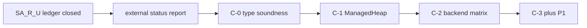

# SYX 项目整体状态

> **维护：** 对外能力叙事、阶段退出或成熟度变更时更新。  
> **活 backlog：** [`02-improvement-roadmap.md`](02-improvement-roadmap.md)（**收敛期 · C-***）  
> **外部审计输入：** [`syx-status-final-report.md`](syx-status-final-report.md)（2026-11 · 只读调查）  
> **上期冻结：**  
> - 可信度 0→4 / Stage ledger → [`archive/`](archive/)  
> - SA / R / U 详账 → [`archive/02-improvement-roadmap-sa-r-u-ledger.md`](archive/02-improvement-roadmap-sa-r-u-ledger.md)  
> - 本文件收敛前快照 → [`archive/01-project-status-pre-convergence.md`](archive/01-project-status-pre-convergence.md)  
> **最近更新：** 2026-11-27 · **C-3bs / C-3bt / C-3bu ReturnErr+ActorSend+TaskSpawn 栈薄地板 `[x]`**；C-0 `[x]` 薄闸（C-0a+ 仍 park）；C-3 `[~]`（a…z+aa…br+bs…bu）；C-5 `[~]`；C-8 `[~]`；C-7 `[~]`；**C-6 `[x]`**；C-4 `[x]`；下一 = **跨轴**（全量 MirOp 余片 / 或 P0 余债；不宣称 C-3/C-5 `[x]`）。

## 1. 一句话现状

**SYX 0.4.0 是可运行窄切片、具备较大工程资产的研究型 beta，尚未达到生产级语言/编译器稳定性。**  
VM / MIR / Wasm / browser 与 LSP 有可重复正向证据；字段默认、继承 pad、extension `self.init` 等语言表面经 U-33…U-40 已闸。当前最大阻断不在「再加语法」，而在：**静态语义不 sound**、**ManagedHeap 默认路径不安全**、**Native/CI 支持边界不一致**。

对齐章程仍见 [stdlib-swift-alignment](../docs/adr/stdlib-swift-alignment.md)；SA 退出见 [sa-exit](../docs/adr/sa-exit.md)。外部详证见 [`syx-status-final-report.md`](syx-status-final-report.md)。

## 2. 版本与冻结

| 项 | 值 |
|----|-----|
| Crate / workspace | **0.4.0**（Cargo `[workspace.package].version` = 公开 SSOT · C-6 `[x]`） |
| 对外 semver | **0.4.0** |
| 程序轨道 | 可信度 0→4 / SA / R-0…R-49 / U-0…U-40 **已退出（账面）**；现开 **收敛期（C-*)** |
| 架构 SSOT | [`docs/adr/architecture-decisions.md`](../docs/adr/architecture-decisions.md) · [`docs/adr/current.md`](../docs/adr/current.md) |
| 语言面 SSOT | [`docs/adr/language-book-ssot.md`](../docs/adr/language-book-ssot.md) + `books/language-guide` |
| 标准库机器清单 | [`packages/internal/manifest.json`](../packages/internal/manifest.json)（优先于历史 MD） |

**默认冻结（直至显式 ADR 解锁）：**

- 产品伞 GA unpark（Farm / SynUI / marketplace scaffold）
- HostFn+1 作为 KPI；新增宏能力扩张
- 命名任何官方模块为 `Foundation`
- 把 JIT Suite-1 / simd Object wipe / 真隐式 `CallSuper` 当默认下一刀
- 把测试数量、HostFn 数量、文档章节数解释为整语言成熟度

品牌：产品名 **SYX**；源文件 **`.sy`**；工程清单 **`syx.toml`**。

## 3. 完成度（账面）

| 轨道 | 状态 | 说明 |
|------|------|------|
| Truth / Wave / Stage 0–4 | `[x]` 退出 | 详账见 `plan/archive/` |
| **SA-0…SA-6** | `[x]` 退出 | Swift 对齐章程期 |
| **R-0…R-49** | `[x]` 收口 | Object 切片 / wasm 46/46 / browser / 诊断 / docs ADR；**无 R-50** |
| **U-0…U-40** | `[x]` 收口 | FilePath / credibility MD / parser 双接受 / 循环控制 / S060 / 字段默认链 / extension lit |
| **收敛期 C-*** | **开账** | C-0 / C-1 / C-2 / **C-4** / **C-6** `[x]`；C-3 `[~]`（C-3a…**z**+**aa**…**ba**+**bb**…**bd**+**be**…**bg**+**bh**…**bi**+**bj**…**bl** `[x]`；全量 MirOp/Call(ModuleId)/HostFn arity/trim remap/global 名表·remap/locals 类型·φ/ConstFnIndex fail-closed(R-33)/CallIndirect 语义/跨块 φ/完整 DefId park；**不**宣称 C-3 `[x]`）；C-5 `[~]`（C-5a…**h** `[x]`；真全量 syscall GA park；**不**宣称 C-5 `[x]`）；C-7 `[~]`；C-8 `[~]`（C-8a…f `[x]`）；活轴见 `02`；矩阵 SSOT [`docs/gates/backend-ci-matrix.md`](../docs/gates/backend-ci-matrix.md) |

**硬 KPI（U-40 census 地板，收敛期默认不破）：** wasm **46/46**；browser **0** failed；Object **≤180/10**；simd residual **≥159**；`sy,output` **12/12**。

## 4. 成熟度快照（指导 · 对齐外部报告）

| 领域 | /5 | 判断 |
|------|---:|------|
| 语法 / 诊断 | 3.0 | 表面广；parser 与书仍有分叉 |
| 语义 / 泛型 / 引用 | **2.0** | **P0**：`Unknown` 可穿过 check；arity/return/`&mut` 不完整 |
| MIR / VM | 3.0 | 窄切片可用；缺 verifier / 稳定 identity |
| Wasm | 3.5 | 46/46 + AOT ratio 1.0；host-assisted ≠ portable sandbox |
| Native LLVM | 2.9 | CI paid hello+path+tcp+sql+http(+types/server/stream/timeout)+pool/row+file×3+tls.client（C-2b-2…13）；16 行产品 `native=real` |
| JIT | 1.5 | Suite-1 pilot；非生产默认 |
| stdlib / HostFn | 3.0 / 2.0 | 表面大；稳定 ABI 与 HostFn 膨胀风险 |
| package / security | 2.9 | 归档/签名好；C-4 默认可复现；C-5a 假 sandbox 承诺已降级（真隔离仍缺） |
| CI / docs / release | 2.9 | C-6 `[x]`；C-7a…c：fuzz + soft-step + count-gate 2600/1700；C-7 仍 `[~]`（scaffold park） |
| LSP / DX | 3.5+ | 1788 lib tests；编辑器面强 |

**综合：约 2.6/5 — 研究型 beta / 受控实验工具链，≠ 生产级 Swift-like 语言。**

## 5. 开放债（对接 `02` 收敛期）

### P0 — 正确性与安全边界（默认下一）

1. **类型 soundness**：C-0a…d + **C-0f** call-arg Unknown sink 已闸；`ErrorType` / `InferenceVar` 三分 / 关软臂 / narrowing 仍 park（C-0a+/C-0e）
2. **ManagedHeap**：C-1 轴已退出（默认降级 · weak identity · immutable 拒写 · churn 叙事清扫）；算法厚修仍 park（C-1a+）  
3. **Backend 支持矩阵**：C-2 `[x]`（SSOT + 16× paid `native=real` + JIT label + `ci.job.*` surface 对齐）；余债 park（`net.tls.server` · macOS full-native）
4. **MIR 输入**：C-3a…C-3z + **C-3aa**…**C-3br** + **C-3bs**…**C-3bu** done；全量 MirOp / Call(ModuleId) IR / HostFn arity / trim remap / global 名表·remap / locals 类型·φ / ConstFnIndex fail-closed（R-33） / CallIndirect 完整 arity / JumpIfNil 高度 / ActorCall · CallSuper / 跨块 φ / 完整 DefId / 完整 exception 仍 park

### P1 — 架构 / 包 / 隔离 / SSOT（默认下一 **跨轴**）

- MIR 唯一可验证后端输入（C-3 `[~]`：C-3a…**z**+**aa**…**br**+**bs**…**bu** done；全量 MirOp/HostFn arity/global 名表/locals 类型·φ/ConstFnIndex fail-closed(R-33)/CallIndirect 完整 arity/完整 DefId park）
- lock/git/path 默认可复现（**C-4 `[x]`**：C-4a…C-4e）；manifest↔lock 全量对账仍 park
- 宏/embed 隔离诚实（C-5 `[~]`：C-5a…**h** done；permission default-on 已落地；真全量 syscall GA / C-5 `[x]` 仍 park）
- 单一 capability/version SSOT（**C-6 `[x]`**：C-6a 对齐 + C-6b gen-from-Cargo）

### P2 / P3 — 反馈质量与维护成本

- 测试矩阵 / fuzz 信号（C-7 `[~]`：C-7a…C-7c done；C-7c+ park）  
- 文档/formatter 诚实（C-8 `[~]`：C-8a…f done；CST lossless 实现 / CallSuper / 去 parser legacy park）  
- 巨型模块拆分；实验 scaffold 移出 stable（C-7c+ park）

**仍 park（非默认下一）：** CST postfix 深刀、codegen Break、JIT Suite-1 扩面、simd Object wipe、SyxHost、真隐式 `CallSuper`、HostFn+1、产品伞 unpark。

## 6. 文档边界

| 位置 | 角色 |
|------|------|
| **`plan/01` + `plan/02`** | 活：状态 + **C-*** backlog |
| **`plan/syx-status-final-report.md`** | 外部只读审计（输入，不替代 `02` 勾选） |
| **`plan/archive/02-…-sa-r-u-ledger.md`** | 冻：SA/R/U 全账 |
| **`docs/adr/`** | 架构决议 |
| **`packages/internal/manifest.json`** | 包表面机器 SSOT |
| **`.cursor/plans/`** | 当前窗施工草稿 |

新工作默认：先改 `02` 勾选 → 必要时 ADR → 再开 `.cursor/plans` 窗口（**C-*** 编号）。

## 7. 上期退出指针

- SA 退出：[sa-exit](../docs/adr/sa-exit.md)  
- Stage-2/3/4 退出：`docs/adr/stage*-exit.md`  
- U/R 详账：[`archive/02-improvement-roadmap-sa-r-u-ledger.md`](archive/02-improvement-roadmap-sa-r-u-ledger.md)  
- 硬 KPI 最近 census：[`docs/census/c-0a-unknown-sink-census.md`](../docs/census/c-0a-unknown-sink-census.md) · [`docs/census/c-0d-mut-ref-arg-census.md`](../docs/census/c-0d-mut-ref-arg-census.md)
